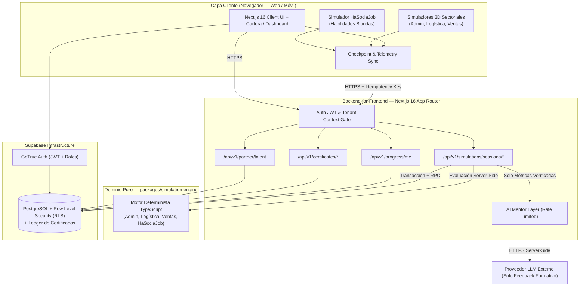
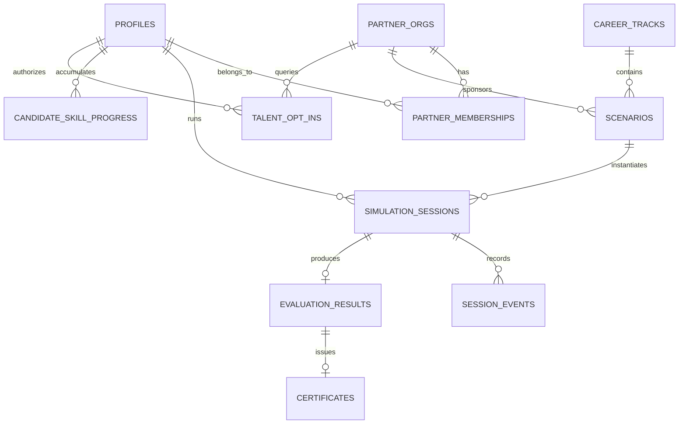

# PortalJob — Simulador Virtual de Prácticas Preprofesionales y Arquitectura Backend

<div align="center">


**Plataforma web B2B2C diseñada para enfrentar el desempleo juvenil en el Perú mediante simuladores virtuales 3D de prácticas preprofesionales (Administración, Logística, Ventas), entrenamiento de habilidades blandas con *HaSociaJob*, retroalimentación con IA, certificación laboral verificable y cartera de talento capacitado.**

[Arquitectura del Sistema](docs/ARCHITECTURE.md) • [Esquema PostgreSQL & RLS](docs/BACKEND_SCHEMA.md) • [Contratos API](docs/API_CONTRACT.md) • [Motor TS vs. IA](docs/ENGINE_AND_AI_SEPARATION.md) • [Flujos End-to-End](docs/USER_AND_DATA_FLOWS.md)

</div>

---

> [!NOTE]
> **Transparencia de Estado del Repositorio (`Technical Blueprint`)**
> Este repositorio documenta la **arquitectura técnica, modelo de datos, políticas de seguridad (RLS), contratos API y diseño del motor determinista** de **PortalJob** (incluyendo el módulo **HaSociaJob**), propuesta reconocida como **Ganador Nacional en la Ideatón Por El Empleo Juvenil**.
>
> Aunque no se programó la versión final productiva completa en código, los artefactos técnicos aquí publicados (migraciones SQL, políticas RLS, contratos REST, ADRs y motor de scoring en TypeScript puro) constituyen un **blueprint listo para implementación** respaldado por un caso de negocio, alcance geográfico y presupuesto estructurados.

---

## 1. Contexto del Problema y Planteamiento de PortalJob

### Rompiendo el Ciclo Vicioso en el Mercado Juvenil Peruano
Miles de jóvenes en el Perú quedan excluidos del empleo formal por la misma barrera estructural: **sin experiencia no hay trabajo, y sin trabajo no hay experiencia**. Para el tejido empresarial, contratar perfiles sin experiencia comprobada eleva el costo de selección, inducción y rotación temprana.

### Solución: Simulador Virtual de Prácticas Preprofesionales (B2B2C)
**PortalJob** opera como un simulador virtual gamificado estructurado en módulos temáticos que replican funciones operativas reales en sectores clave (**Administración, Logística y Ventas**), complementado por el módulo de habilidades blandas **HaSociaJob**:

| Pilar de PortalJob | Qué hace funcionalmente | Respaldo en la Arquitectura Backend |
| :--- | :--- | :--- |
| **1. Simuladores Interactivos (Admin, Logística, Ventas)** | Tareas prácticas reales: gestión de reportes, trabajo en equipo, habilidades digitales y protocolos de seguridad laboral. | Checkpoints versionados (`state_snapshot`), bitácora *append-only* (`session_events`) e idempotencia ante micro-cortes. |
| **2. HaSociaJob (Habilidades Blandas)** | Simulador dedicado a fortalecer comunicación efectiva, liderazgo, resolución de problemas y adaptabilidad. | Motor determinista situacional en TypeScript puro + evaluación objetiva por rúbrica antes de invocar al mentor IA. |
| **3. Retroalimentación Personalizada con IA** | Analiza desempeño, identifica fortalezas/brechas y sugiere micro-acciones de mejora. | Capa LLM estrictamente desacoplada del puntaje (`LLM ≠ Motor Numérico`), con cuotas diarias por usuario. |
| **4. Certificación Laboral Verificable** | Modelo de certificación co-avalada (propuesto con MTPE y empresas aliadas objetivo como BCP, ManPower y Telefónica). | Tabla `certificates` inmutable ligada a `evaluation_results`, código único de verificación y hash determinista. |
| **5. Intermediación Laboral (Cartera de Talento)** | Conecta a jóvenes capacitados con empresas aliadas a partir de competencias demostradas. | Políticas RLS multi-tenant y tabla `talent_opt_ins` con consentimiento explícito y filtros por región/vertical. |

---

## 2. Mi Rol Técnico y Liderazgo como Arquitecto Backend

En el diseño de **PortalJob**, lideré la arquitectura del servidor, los datos y la seguridad para garantizar escalabilidad nacional, protección de datos y confiabilidad comercial frente a empresas aliadas:

1. **Backend-for-Frontend (`Next.js 16 App Router`):** Diseño de Route Handlers versionados (`/api/v1/*`) con validación Zod, control de concurrencia optimista (`state_version`) e idempotencia en telemetría 3D.
2. **Arquitectura de Datos y Migraciones SQL (`Supabase / PostgreSQL`):** Diseño integral de las tablas de perfiles multi-rol, tracks sectoriales, sesiones resumibles, auditoría de eventos, certificaciones verificables y cartera de talento B2B.
3. **Ciberseguridad, Protección de Datos y RLS:** Aislamiento *deny-by-default* en PostgreSQL alineado a principios de protección de datos personales (Ley N.º 29733 — Perú), bloqueando manipulación de puntajes/XP desde el cliente y exigiendo *opt-in* explícito para visibilidad B2B.
4. **Motor Determinista en TypeScript Puro (`packages/simulation-engine`):** Separación estricta entre el cálculo numérico determinista (KPIs operativos, SLA, seguridad laboral y competencias *HaSociaJob*) y la capa de interpretación pedagógica por IA.
5. **APIs de Progreso, Certificación e Intermediación:** Endpoints diseñados para rastrear avance por competencia, emitir/verificar certificados y filtrar talento por vertical y región geográfica.

---

## 3. Arquitectura del Sistema (Vista C4)



---

## 4. Separación Estricta: Motor Determinista vs. IA Personalizada

Para que una certificación laboral respaldada por empresas aliadas y entidades como el MTPE tenga validez real, **la IA nunca califica ni asigna XP**:

```text
Eventos del Simulador (Admin / Logística / Ventas / HaSociaJob)
              │
              ▼
  [ Motor Determinista en TypeScript Puro ]   ◄── 0 dependencias React / Red / LLM
   • Valida tiempos mínimos anti-trampa y orden secuencial
   • Evalúa KPIs por sector: reportes, FEFO/EPP, conversión, liderazgo/comunicación
   • Calcula score (0-100), aprobación, XP y genera inputHash reproducible
              │
              ▼  (Persistencia atómica + emisión de certificado si aprueba)
    [ PostgreSQL + RLS + Ledger Inmutable ]
              │
              ▼  (Lectura read-only de brechas reales)
      [ Capa IA de Retroalimentación ]        ◄── Explica fortalezas y plan de mejora
```

> Revisar fórmulas y reglas por módulo en [docs/ENGINE_AND_AI_SEPARATION.md](docs/ENGINE_AND_AI_SEPARATION.md) y [ADR-001](docs/adr/001-deterministic-ts-engine-vs-ai.md).

---

## 5. Arquitectura de Datos, Certificación y Seguridad (RLS)



### Controles de Ciberseguridad y Protección de Datos
* **Frontera Zero-Trust en PostgreSQL (`002_rls_policies.sql`):** Cada fila en `simulation_sessions`, `session_events`, `evaluation_results`, `certificates` y `talent_opt_ins` está protegida por RLS *deny-by-default*.
* **Protección de Datos y Consentimiento B2B:** Ninguna empresa aliada puede consultar el perfil o desempeño de un joven en la **cartera de talento** si el usuario no otorgó consentimiento explícito (`talent_opt_ins.consent_status = 'granted'`), alineado al principio de autodeterminación informativa (Ley N.º 29733).
* **Anti-Tampering de Puntajes y Certificados:** Las tablas `evaluation_results`, `candidate_skill_progress` y `certificates` bloquean escritura directa desde clientes (`authenticated`), permitiendo mutaciones únicamente mediante la RPC transaccional `commit_deterministic_evaluation` ejecutada en servidor (`service_role`).
* **Verificación Pública Segura de Certificados:** Mediante la función `verify_certificate(code)` y el endpoint `/api/v1/certificates/verify/[code]`, cualquier empleador puede validar la autenticidad de un certificado sin acceder al listado privado de usuarios.

> Ver detalle completo en [docs/BACKEND_SCHEMA.md](docs/BACKEND_SCHEMA.md) y [ADR-004](docs/adr/004-verifiable-credentials-and-data-protection.md).

---

## 6. Módulos Cubiertos por el Motor y Catálogo Seed

| Vertical / Módulo | Código de Track | Competencias Evaluadas por el Motor TS |
| :--- | :--- | :--- |
| **Logística & Seguridad Laboral** | `LOGISTICS_CORE` | Picking FIFO/FEFO, verificación obligatoria de EPP, precisión de despacho y cumplimiento de SLA. |
| **Administración & Habilidades Digitales** | `ADMIN_CORE` | Gestión de reportes operativos, detección de inconsistencias de datos/facturación y priorización documental. |
| **Ventas & Atención Comercial** | `SALES_CORE` | Diagnóstico de necesidad del cliente, manejo de objeciones, ética comercial y tasa de cierre. |
| **HaSociaJob (Habilidades Blandas)** | `HASOCIAJOB_SOFT` | Comunicación efectiva, liderazgo de equipo, resolución de conflictos, trabajo en equipo y adaptabilidad. |

---

## 7. Superficie de APIs (Next.js 16 App Router)

| Método & Ruta | Propósito | Control de Seguridad |
| :--- | :--- | :--- |
| `GET /api/v1/health` | Estado del BFF, conectividad PostgreSQL y versión del motor | Público (sin PII) |
| `GET /api/v1/scenarios` | Catálogo filtrable (`administration`, `logistics`, `sales`, `hasociajob`) | Auth JWT + RLS |
| `POST /api/v1/simulations/sessions` | Inicia o reanuda sesión activa/pausada | Auth JWT + Índice único parcial |
| `PATCH /api/v1/simulations/sessions/[id]/checkpoint` | Guarda `state_snapshot` e inserta eventos idempotentes | Auth JWT + `state_version` optimista |
| `POST /api/v1/simulations/sessions/[id]/submit` | Ejecuta motor TS determinista, actualiza XP y emite certificado si aprueba | Auth JWT + Lock transaccional |
| `POST /api/v1/simulations/sessions/[id]/ai-feedback` | Genera retroalimentación personalizada y plan de mejora | Auth JWT + Rate Limit diario |
| `GET /api/v1/progress/me` | Progreso consolidado, nivel, XP por competencia y certificados propios | Auth JWT + RLS |
| `GET /api/v1/certificates/verify/[code]` | Validación de autenticidad de certificación laboral por empleadores | Código único verificable (sin exposición masiva) |
| `GET /api/v1/partner/talent` | Cartera de talento capacitado filtrable por vertical, score y región (`Lima`, `Arequipa`, `Piura`) | Auth JWT + Membership B2B + Opt-in obligatorio |

> Especificación completa de payloads y códigos de error en [docs/API_CONTRACT.md](docs/API_CONTRACT.md).

---

## 8. Impacto, Alcance Geográfico y Proyección de Implementación

### Despliegue Progresivo (Hoja de Ruta de 18 Meses)
```text
Meses 1–6:  Lima Metropolitana (Piloto B2C + primeras alianzas empresariales y validación de rúbricas)
     │
     ▼
Meses 7–12: Expansión a Arequipa y Piura (Regionalización de cartera de talento en profiles.region)
     │
     ▼
Meses 13–18: Cobertura Nacional (Estandarización de co-certificación y escalamiento multi-tenant)
```

### Retos Estratégicos y Mitigación Arquitectónica
* **Colaboración Empresarial:** Retos patrocinados (`scenarios.partner_org_id`) para que empresas aliadas modelen tareas reales de sus áreas de Administración, Logística y Ventas sin exponer datos productivos internos.
* **Viabilidad Financiera & Ecosistema Institucional:** Propuesta diseñada para articular apoyo institucional con entidades como **MTPE**, **OIT** y programas como **Impulsa Perú**, junto con alianzas corporativas objetivo (ej. **BCP, ManPower, Telefónica**).
* **Escalabilidad & Ciberseguridad:** BFF *stateless* en Next.js 16, control de costos de IA por cuotas y separación de tablas calientes de telemetría frente a vistas resumidas de progreso.

### Proyección Financiera de Implementación (Propuesta Integral)

| Partida Presupuestal | Rango Estimado (USD) | Alcance Principal |
| :--- | :---: | :--- |
| **Desarrollo tecnológico** | USD 35,000 – 41,000 | Construcción MVP completo (Simuladores 3D, *HaSociaJob*, BFF Next.js, motor TS e IA). |
| **Infraestructura y soporte** | USD 13,000 – 16,500 | Supabase/PostgreSQL, hosting serverless, almacenamiento, monitoreo y soporte operativo. |
| **Recursos humanos** | USD 78,000 – 93,000 | Equipo multidisciplinario (Ingeniería, Diseño 3D/UX, Pedagogía Laboral, Gestión). |
| **Promoción y alianzas** | USD 14,000 – 18,000 | Adquisición de talento joven y articulación con empresas aliadas y programas públicos. |
| **Mantenimiento y expansión** | USD 80,000 | Operación continua, soporte evolutivo y despliegue regional (Lima → Arequipa / Piura → Nacional en 18 meses). |
| **Total Estimado** | **USD 220,000 – 250,500** | **Cobertura integral de desarrollo, despliegue y expansión a 18 meses.** |

---

## 9. Estructura del Repositorio y Verificación Local

```text
portal-job/
├── README.md                                        # Documento maestro: contexto, rol backend, arquitectura y presupuesto
├── LICENSE                                          # Licencia MIT
├── .env.example                                     # Plantilla segura de variables de entorno
├── docs/
│   ├── ARCHITECTURE.md                              # Diagramas C4, regionalización y escalabilidad
│   ├── BACKEND_SCHEMA.md                            # ERD, certificados, RLS multi-tenant e índices
│   ├── API_CONTRACT.md                              # Contratos REST v1, verificación de certificados y cartera B2B
│   ├── ENGINE_AND_AI_SEPARATION.md                  # Motor TS (Admin, Logística, Ventas, HaSociaJob) vs. IA
│   ├── USER_AND_DATA_FLOWS.md                       # Secuencias end-to-end y máquina de estados
│   └── adr/
│       ├── 001-deterministic-ts-engine-vs-ai.md     # Separación estricta scoring determinista vs. LLM
│       ├── 002-supabase-rls-multitenancy.md         # RLS deny-by-default para B2C y empresas aliadas
│       ├── 003-nextjs16-bff-and-state-persistence.md # Checkpoints versionados e idempotencia
│       └── 004-verifiable-credentials-and-data-protection.md # Certificación verificable y protección de datos
├── supabase/
│   └── migrations/
│       ├── 001_init_schema.sql                      # DDL: tracks, escenarios, sesiones, evaluaciones y certificados
│       ├── 002_rls_policies.sql                     # Políticas RLS multi-tenant y verificación segura
│       ├── 003_triggers_and_functions.sql           # Triggers anti-tamper, RPC transaccional y verify_certificate
│       └── 004_seed_catalog.sql                     # Seed real: Logística, Administración, Ventas y HaSociaJob
└── packages/
    └── simulation-engine/
        ├── tsconfig.json                            # Configuración TypeScript estricta (0 deps externas)
        ├── types.ts                                 # Contratos de dominio para las 4 verticales
        ├── scoring-contract.ts                      # Motor determinista puro y máquina de estados
        └── scoring-contract.test.ts                 # Suite ejecutable (node --test)
```

### Verificación Local del Motor Determinista
El contrato del motor en TypeScript puro se ejecuta directamente con Node.js 22.6+/24+ sin instalar dependencias:

```bash
node --test packages/simulation-engine/scoring-contract.test.ts
```

---

<div align="center">

**Autor & Arquitecto Backend:** Max Clever Quintana Morales  
[LinkedIn](https://www.linkedin.com/in/max-quintana-morales/) • [GitHub](https://github.com/waxmorales)

</div>
