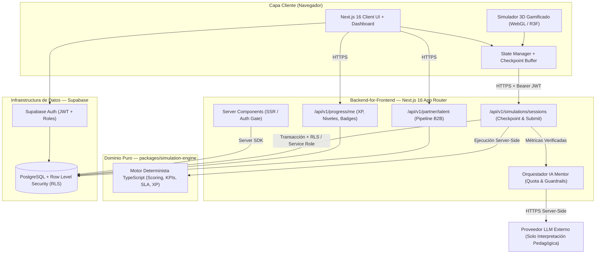
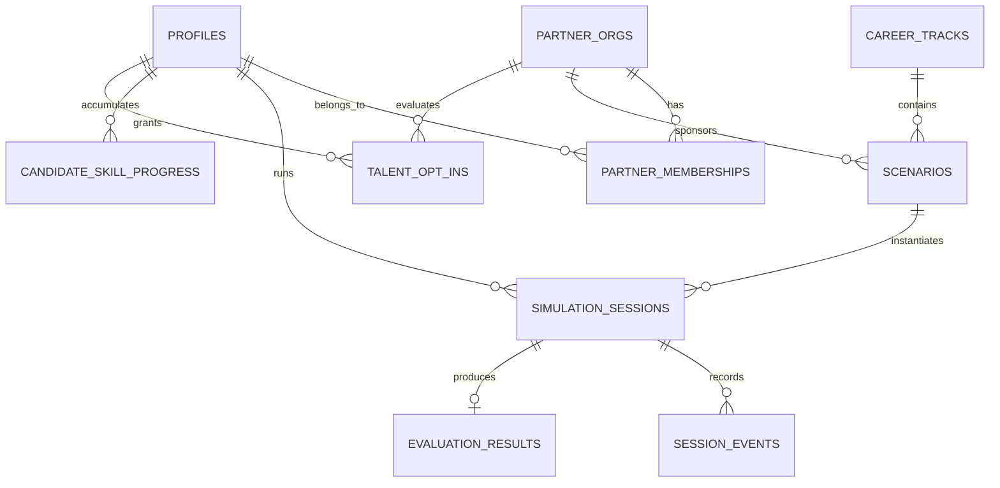

# Portal Job — Arquitectura Backend, Datos y Simulación 3D para Empleabilidad Juvenil

<div align="center">


**Plataforma web B2B2C diseñada para resolver la paradoja de la primera experiencia laboral en jóvenes mediante simuladores operativos 3D gamificados, evaluación determinista de desempeño y conexión directa con empresas aliadas.**

[Arquitectura del Sistema](docs/ARCHITECTURE.md) • [Esquema PostgreSQL & RLS](docs/BACKEND_SCHEMA.md) • [Contratos API](docs/API_CONTRACT.md) • [Motor TS vs. IA](docs/ENGINE_AND_AI_SEPARATION.md) • [Flujos End-to-End](docs/USER_AND_DATA_FLOWS.md)

</div>

---

> [!NOTE]
> **Transparencia de Estado del Repositorio (`Technical Blueprint`)**
> Este repositorio documenta la **arquitectura técnica, modelo de datos, políticas de seguridad (RLS), contratos API y diseño del motor determinista** de **Portal Job**, proyecto reconocido como **Ganador Nacional en la Ideatón Por El Empleo Juvenil**.
>
> Aunque no se programó la versión final productiva completa en código, los artefactos técnicos aquí publicados (migraciones SQL, políticas RLS, contratos REST y contratos de tipos en TypeScript puro) constituyen un **blueprint listo para implementación** con valor técnico y comercial validado.

---

## 1. Contexto del Problema y Propuesta de Valor Comercial

### La Paradoja de la Primera Experiencia
Miles de jóvenes egresados o estudiantes enfrentan el mismo bloqueo estructural al ingresar al mercado laboral: **las empresas exigen experiencia previa verificable, pero los jóvenes no pueden obtener experiencia si nadie les da su primera oportunidad**. Del lado corporativo, los procesos de selección para perfiles operativos y administrativos iniciales sufren alta rotación, costos elevados de capacitación y baja predictibilidad sobre el desempeño real del candidato.

### Cómo lo resuelve Portal Job (Modelo B2B2C)
**Portal Job** reemplaza el filtrado ciego basado únicamente en un CV vacío por **evidencia práctica simulada**:

| Actor | Problema Actual | Valor Entregado por Portal Job |
| :--- | :--- | :--- |
| **Talento Joven (B2C)** | Sin experiencia demostrable; cursos teóricos desconectados de la operación real. | Entrena en **escenarios 3D gamificados** inspirados en tareas reales (Logística, RRHH, Operaciones), acumula XP, micro-capacitaciones y obtiene un **dossier verificable de competencias**. |
| **Empresas Aliadas (B2B)** | Alto costo de screening, pruebas técnicas costosas y rotación temprana en puestos junior/operativos. | Publican retos basados en sus procesos reales y acceden a **talento pre-evaluado con métricas objetivas de KPI/SLA** antes de la entrevista final. |

---

## 2. Mi Rol Técnico y Responsabilidades como Arquitecto Backend

En el diseño técnico de **Portal Job**, lideré la arquitectura del backend, la seguridad de los datos y la separación de responsabilidades entre el cálculo determinista y la capa de Inteligencia Artificial:

1. **Arquitectura Backend & BFF (`Next.js 16 App Router`):** Diseño de Route Handlers versionados (`/api/v1/*`) con validación estricta de payloads, control de concurrencia optimista (`state_version`), idempotencia en telemetría y desacoplamiento de escritura privilegiada.
2. **Arquitectura de Datos & Migraciones SQL (`Supabase / PostgreSQL`):** Modelado relacional multi-tenant con trazabilidad completa desde el evento en el simulador 3D hasta el perfil de empleabilidad del candidato y el matching con empresas aliadas.
3. **Frontera de Seguridad Zero-Trust (`Row Level Security`):** Diseño de políticas RLS granulares que aíslan datos privados de candidatos, protegen retos corporativos B2B y bloquean la manipulación client-side de puntajes y experiencia (XP).
4. **Persistencia de Estado Resumible:** Modelo híbrido de *checkpoints* de estado JSONB + bitácora *append-only* de eventos de simulación para tolerar desconexiones en sesiones largas de entrenamiento 3D y habilitar auditoría anti-trampa.
5. **Motor de Simulación y Lógica de Negocio en TypeScript Puro:** Separación estricta entre el **procesamiento numérico determinista** (cálculo de KPIs, penalizaciones SLA, precisión operativa y XP) y la **interpretación de IA** (mentoría y retroalimentación formativa).
6. **Infraestructura Orientada a Estabilidad y Escalabilidad:** Rate limiting para consumo de LLMs, índices compuestos y parciales en PostgreSQL, separación entre tablas transaccionales calientes y resúmenes agregados de progreso.

---

## 3. Vista Rápida de la Arquitectura del Sistema



---

## 4. Principio Arquitectónico Clave: Motor Determinista ≠ IA

Un error común en plataformas EdTech con IA es delegar al LLM la evaluación numérica del usuario, generando notas inconsistentes, alucinaciones o vulnerabilidades frente a *prompt injection*. En **Portal Job**, la arquitectura impone una frontera infranqueable:

```text
Eventos del Simulador 3D (Logística / RRHH)
              │
              ▼
  [ Motor Determinista en TypeScript Puro ]   ◄── Sin React, sin Red, sin LLM
   • Valida reglas operativas (FIFO, SLA, Seguridad, Políticas RRHH)
   • Calcula KPIs reales, puntaje (0-100), XP y rango de aprobación
   • Genera hash de entrada + versión del motor para reproducibilidad
              │
              ▼  (Solo métricas verificadas e inmutables)
    [ Persistencia PostgreSQL + RLS ]
              │
              ▼  (Lectura contextual)
      [ Capa de IA Mentor (LLM) ]             ◄── Nunca modifica puntajes ni XP
   • Explica por qué ocurrió cada penalización
   • Recomienda micro-capacitaciones específicas según brechas reales
```

> Ver especificación completa y reglas de dominio en [docs/ENGINE_AND_AI_SEPARATION.md](docs/ENGINE_AND_AI_SEPARATION.md) y [ADR-001](docs/adr/001-deterministic-ts-engine-vs-ai.md).

---

## 5. Arquitectura de Datos, Seguridad (RLS) y Persistencia de Estado

El modelo de base de datos en **Supabase (PostgreSQL)** está organizado en **4 dominios lógicos** que cubren desde el catálogo gamificado hasta el pipeline de contratación B2B:



### Decisiones Críticas de Backend y Seguridad
* **Integridad de XP y Evaluaciones (Anti-Tampering):** Las tablas `simulation_sessions` (en transición a `evaluated`), `evaluation_results` y `candidate_skill_progress` **no aceptan `INSERT`/`UPDATE` directo desde el cliente** sobre columnas de puntaje. Toda evaluación se calcula en servidor mediante el motor TypeScript y se persiste bajo verificación transaccional.
* **Aislamiento Multi-Tenant B2B/B2C (RLS):**
  * Un **Candidato** solo accede a sus sesiones, checkpoints, eventos y progreso propio.
  * Una **Empresa Aliada** solo gestiona sus retos patrocinados y únicamente consulta candidatos que otorgaron **consentimiento explícito (`talent_opt_ins`)** o postularon a su reto.
* **Resiliencia ante Desconexiones:** Cada sesión mantiene un campo `state_snapshot` (`jsonb`) con control de versión optimista (`state_version = expected_version + 1`) y una bitácora idempotente `session_events` (`UNIQUE(session_id, idempotency_key)`). Si el navegador se cierra a mitad de una tarea logística en 3D, el candidato retoma exactamente en el mismo *checkpoint*.

> Revisar el esquema completo, índices, triggers y matriz RLS en [docs/BACKEND_SCHEMA.md](docs/BACKEND_SCHEMA.md) y las migraciones SQL reales en [`supabase/migrations/`](supabase/migrations/001_init_schema.sql).

---

## 6. Superficie de APIs (Next.js 16 App Router)

| Método & Ruta | Propósito | Seguridad / Control |
| :--- | :--- | :--- |
| `GET /api/v1/health` | Healthcheck de infraestructura, latencia DB y versión de esquema | Público (sin exposición de PII) |
| `GET /api/v1/scenarios` | Catálogo de simulaciones 3D por vertical (`logistics`, `hr`, `operations`) y dificultad | JWT / Catálogo público curado |
| `POST /api/v1/simulations/sessions` | Crea una nueva sesión o recupera la última sesión activa/pausada | Auth JWT + RLS + Límite de sesiones activas |
| `PATCH /api/v1/simulations/sessions/[id]/checkpoint` | Persiste checkpoint del simulador 3D y lote de eventos de telemetría | Auth JWT + `state_version` optimista + `idempotency_key` |
| `POST /api/v1/simulations/sessions/[id]/submit` | Cierra la simulación, ejecuta el motor TS determinista y actualiza XP/skills | Auth JWT + Lock transaccional + Validación anti-cheat |
| `POST /api/v1/simulations/sessions/[id]/ai-feedback` | Genera feedback formativo basado únicamente en `evaluation_results` | Auth JWT + Rate Limit diario por usuario |
| `GET /api/v1/progress/me` | Retorna XP total, nivel, radar de habilidades, historial e insignias | Auth JWT + Consulta indexada con RLS |
| `GET /api/v1/partner/talent` | Pipeline B2B para empresas aliadas: filtra candidatos pre-calificados | Auth JWT + Membership Org + Opt-in obligatorio |

> Contratos detallados de request/response, códigos de error e idempotencia en [docs/API_CONTRACT.md](docs/API_CONTRACT.md).

---

## 7. Escenarios Soportados en el Simulador (Ejemplos de Dominio)

### Vertical 1: Logística y Operaciones de Almacén
* **Misión ejemplo:** *Picking, despacho FIFO/FEFO y gestión de incidencias bajo presión de SLA.*
* **Variables evaluadas por el motor TS:** Precisión de SKU (% de acierto), respeto de rotación FEFO/FIFO, cumplimiento de protocolos EPP/seguridad, tiempo de ciclo vs. SLA objetivo y merma evitada.

### Vertical 2: Recursos Humanos y Gestión de Talento
* **Misión ejemplo:** *Pre-selección objetiva, gestión de clima laboral y resolución de incidencias contractuales.*
* **Variables evaluadas por el motor TS:** Coincidencia con rúbrica del puesto, ausencia de sesgos/criterios discriminatorios (regla de cumplimiento), priorización de escalamientos críticos y adherencia a normativa laboral básica.

---

## 8. Infraestructura, Estabilidad y Escalabilidad

* **Stateless Compute en BFF:** Los Route Handlers de Next.js 16 no mantienen estado en memoria entre peticiones, permitiendo escalado horizontal automático en edge/serverless.
* **Protección contra Picos y Costos de IA:** Separar el scoring (0 costo de API externa, ejecución en <5 ms en TypeScript) del feedback LLM permite atender miles de simulaciones concurrentes sin cuellos de botella ni costos lineales por cada acción del usuario.
* **Estrategia de Indexación PostgreSQL:** Índices compuestos `(user_id, created_at DESC)` para historiales, índice único parcial para garantizar máximo una sesión activa por escenario/usuario, e índice compuesto `(session_id, sequence_num)` para reconstrucción ordenada de eventos.
* **Observabilidad Planificada:** Correlación por `request_id` y `session_id`, registro de `engine_version` en cada resultado para auditorías retrospectivas si cambian las rúbricas de negocio.

---

## 9. Estructura Completa del Repositorio

```text
portal-job/
├── README.md                                     # Visión ejecutiva, rol backend y mapa técnico
├── LICENSE                                       # Licencia MIT
├── .env.example                                  # Plantilla segura de variables de entorno
├── docs/
│   ├── ARCHITECTURE.md                           # Diagramas C4 (Contexto, Contenedores) y escalabilidad
│   ├── BACKEND_SCHEMA.md                         # ERD, tablas, índices, JSONB y matriz de políticas RLS
│   ├── API_CONTRACT.md                           # Especificación REST v1, errores, locks e idempotencia
│   ├── ENGINE_AND_AI_SEPARATION.md               # Diseño del motor determinista TS y frontera con IA
│   ├── USER_AND_DATA_FLOWS.md                    # Diagramas de secuencia y máquina de estados de sesión
│   └── adr/
│       ├── 001-deterministic-ts-engine-vs-ai.md  # Por qué el scoring es TypeScript determinista y no LLM
│       ├── 002-supabase-rls-multitenancy.md      # Por qué RLS en PostgreSQL es la frontera de seguridad
│       └── 003-nextjs16-bff-and-state-persistence.md # Por qué Next.js 16 BFF + checkpoints versionados
├── supabase/
│   └── migrations/
│       ├── 001_init_schema.sql                   # DDL completo: tablas, enums, constraints e índices
│       ├── 002_rls_policies.sql                  # Políticas Row Level Security (B2C, B2B, Ledger)
│       ├── 003_triggers_and_functions.sql        # Onboarding auth, triggers de integridad y agregación
│       └── 004_seed_catalog.sql                  # Datos semilla de tracks y misiones Logística / RRHH
└── packages/
    └── simulation-engine/
        ├── tsconfig.json                         # Configuración TypeScript estricta (sin deps externas)
        ├── types.ts                              # Contratos de dominio, eventos, KPIs y evaluación
        ├── scoring-contract.ts                   # Referencia de motor determinista puro y máquina de estado
        └── scoring-contract.test.ts              # Suite ejecutable (node --test) de invariantes y anti-tampering
```

### Verificación Rápida del Contrato Determinista (Local)
El paquete `packages/simulation-engine` no requiere dependencias externas y puede verificarse directamente con Node.js 22.6+/24+:

```bash
node --test packages/simulation-engine/scoring-contract.test.ts
```

---

## 10. Índice de Documentación Técnica y Blueprint

| Artefacto | Qué demuestra para ingeniería Backend | Estado |
| :--- | :--- | :---: |
| [docs/ARCHITECTURE.md](docs/ARCHITECTURE.md) | Modelado C4, aislamiento de capas, decisiones de latencia, escalabilidad y observabilidad | ✅ Completo |
| [docs/BACKEND_SCHEMA.md](docs/BACKEND_SCHEMA.md) | Modelado relacional B2B2C, ERD, diseño de índices, triggers y matriz de seguridad RLS | ✅ Completo |
| [docs/API_CONTRACT.md](docs/API_CONTRACT.md) | Diseño de APIs RESTful idempotentes, concurrencia optimista, rate limiting y contratos JSON | ✅ Completo |
| [docs/ENGINE_AND_AI_SEPARATION.md](docs/ENGINE_AND_AI_SEPARATION.md) | Lógica de negocio en TypeScript puro, trazabilidad determinista y control de alucinaciones IA | ✅ Completo |
| [docs/USER_AND_DATA_FLOWS.md](docs/USER_AND_DATA_FLOWS.md) | Diagramas de secuencia (Simulación, Persistencia, Matching B2B) y máquina de estados | ✅ Completo |
| [`supabase/migrations/`](supabase/migrations/001_init_schema.sql) | DDL PostgreSQL ejecutable con RLS multi-tenant y seed de Logística/RRHH | ✅ Blueprint SQL |
| [`packages/simulation-engine/`](packages/simulation-engine/types.ts) | Contratos estrictos de tipos y referencia ejecutable del motor en TypeScript puro | ✅ Blueprint TS |
| Código productivo completo (UI 3D + App Router) | Implementación end-to-end del MVP comercial | 🗺️ Roadmap |

---

## 11. Hoja de Ruta hacia MVP Productivo

- [x] **Fase 0 — Arquitectura & Diseño Validado:** Modelo de negocio B2B2C, ganador nacional en *Ideatón Por El Empleo Juvenil*, esquema PostgreSQL/RLS, contratos API y contratos del motor TS.
- [ ] **Fase 1 — Infraestructura Base:** Provisionamiento del proyecto Supabase, ejecución de migraciones `001`–`004` y despliegue del esqueleto Next.js 16 (App Router) con auth JWT.
- [ ] **Fase 2 — Core Backend & Motor Determinista:** Implementación completa de los evaluadores para *Logística* y *RRHH* con suite de pruebas unitarias e integración.
- [ ] **Fase 3 — Integración Simulador 3D & AI Mentor:** Conexión de checkpoints desde escena WebGL/Three.js y activación de mentoría IA con cuotas por usuario.
- [ ] **Fase 4 — Portal B2B Empresas Aliadas:** Activación del tablero de talento verificado por competencias y retos patrocinados.

---

<div align="center">

**Autor & Arquitecto Backend:** Max Clever Quintana Morales  
[LinkedIn](https://www.linkedin.com/in/max-quintana-morales/) • [GitHub](https://github.com/waxmorales)

</div>
