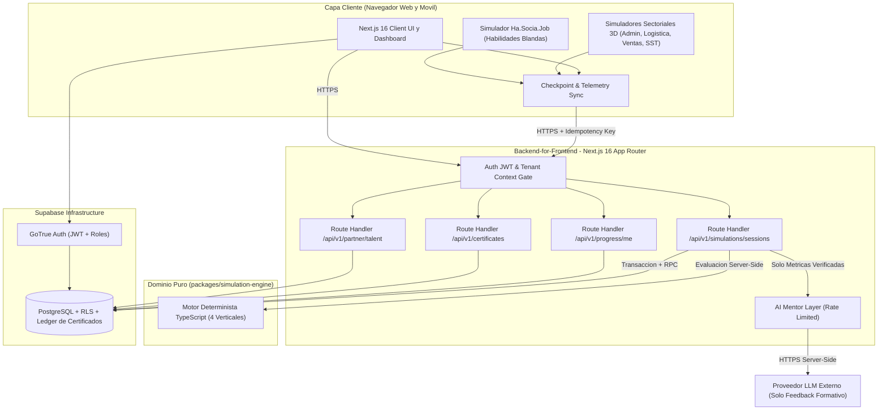
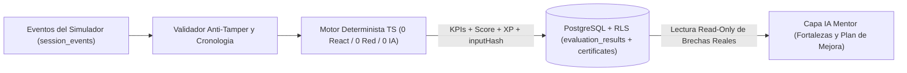
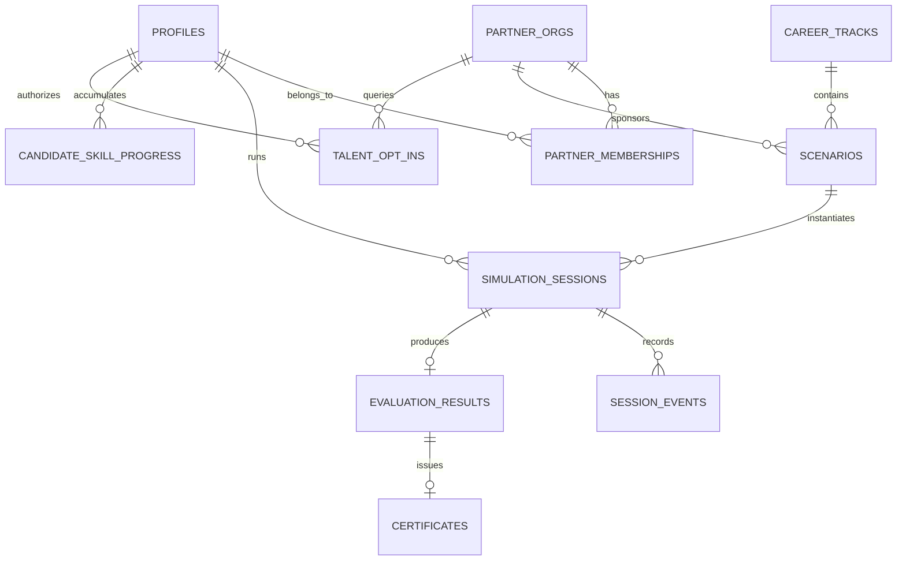

# PortalJob — Arquitectura Backend, Datos y Motor Determinista de Simulación Laboral

<div align="center">

[](https://github.com/waxmorales/portal-job/actions/workflows/test.yml)


**Arquitectura backend B2B2C para plataforma de simulación de prácticas preprofesionales (Administración, Logística/SST, Ventas y *Ha.Socia.Job*), evaluación determinista en TypeScript puro, certificación laboral verificable y cartera de talento protegida con Row Level Security.**

[Arquitectura C4](docs/ARCHITECTURE.md) • [Esquema PostgreSQL & RLS](docs/BACKEND_SCHEMA.md) • [Contratos API](docs/API_CONTRACT.md) • [Motor TS vs. IA](docs/ENGINE_AND_AI_SEPARATION.md) • [Caso de Negocio y Presupuesto](docs/BUSINESS_CASE.md)

</div>

---

> [!NOTE]
> **Transparencia de Estado (`Technical Blueprint`)**
> Este repositorio publica la **arquitectura backend, migraciones SQL, políticas RLS, contratos REST y motor de scoring en TypeScript puro** de **PortalJob** (proyecto reconocido como **Ganador Nacional en la Ideatón Por El Empleo Juvenil**). Aunque la aplicación final productiva no se programó como software desplegado, este diseño resuelve los retos críticos de concurrencia, integridad de certificaciones, protección de datos y escalabilidad.

---

## 1. Resumen Técnico y Contexto del Dominio

**PortalJob** resuelve la brecha de primera experiencia laboral juvenil simulando tareas reales de empresas en **Administración, Logística (con Seguridad y Salud en el Trabajo) y Ventas**, además de habilidades blandas mediante **Ha.Socia.Job**, conectando a jóvenes capacitados con empresas aliadas a través de una cartera de talento verificada.

> El detalle completo de cifras de mercado (INEI), plan de expansión regional (Lima, Piura, Lambayeque, Arequipa), alianzas propuestas (MTPE, OIT, BCP, ManPowerGroup, Telefónica) y proyección presupuestal (`USD 220,000 – 250,500`) se encuentra separado en [docs/BUSINESS_CASE.md](docs/BUSINESS_CASE.md).

---

## 2. Rol Backend e Ingeniería Aplicada

Como **Co-fundador Técnico y Arquitecto Backend**, lideré el diseño de infraestructura, modelo de datos y lógica de negocio:

* **BFF Stateless (`Next.js 16 App Router`):** Route Handlers versionados (`/api/v1/*`) con validación Zod en el borde, control de concurrencia optimista (`state_version`) e idempotencia en telemetría de simuladores.
* **Arquitectura de Datos (`Supabase / PostgreSQL`):** Migraciones SQL (`001`–`004`) para tracks sectoriales, sesiones resumibles, bitácora *append-only* (`session_events`), certificaciones verificables (`certificates`) y matching B2B regionalizado.
* **Seguridad Zero-Trust & Ley N.º 29733 (`Row Level Security`):** Políticas *deny-by-default* con funciones `SECURITY DEFINER`, protección contra alteración client-side de `XP`/puntajes y consentimiento explícito (`talent_opt_ins`) para visibilidad empresarial.
* **Motor Determinista en TypeScript Puro (`packages/simulation-engine`):** Separación estricta entre cálculo numérico de KPIs/SLA/SST y la capa de retroalimentación con IA.

---

## 3. Arquitectura del Sistema (Vista C4)



---

## 4. Separación Estricta: Motor Determinista vs. IA Personalizada

Ningún puntaje ni certificado laboral depende de la respuesta probabilística de un LLM:



* Ver fórmulas, ponderaciones e invariantes en [docs/ENGINE_AND_AI_SEPARATION.md](docs/ENGINE_AND_AI_SEPARATION.md) y [ADR-001](docs/adr/001-deterministic-ts-engine-vs-ai.md).

---

## 5. Arquitectura de Datos, Certificación y Seguridad (ERD + RLS)



### Garantías Clave en PostgreSQL (`supabase/migrations/`)
* **Anti-Tampering Transaccional (`003_triggers_and_functions.sql`):** Los clientes (`authenticated`) no pueden insertar ni modificar `evaluation_results`, `certificates`, `candidate_skill_progress` ni `profiles.total_xp`. Todo dictamen pasa por la RPC `commit_deterministic_evaluation(...)` ejecutada en servidor (`service_role`).
* **Resiliencia con Concurrencia Optimista:** `simulation_sessions` exige `state_version = old.state_version + 1` y `session_events` deduplica reintentos de red mediante `UNIQUE (session_id, idempotency_key)`.
* **Privacidad Multi-Tenant (`002_rls_policies.sql`):** Las empresas aliadas solo supervisan sesiones y métricas de candidatos con `talent_opt_ins.consent_status = 'granted'`; los certificados se validan puntualmente vía `verify_certificate(code)` sin exponer listados de usuarios.

---

## 6. Superficie de APIs (Next.js 16 App Router)

| Método & Ruta | Propósito | Control de Seguridad |
| :--- | :--- | :--- |
| `GET /api/v1/health` | Estado del BFF, conectividad PostgreSQL y versión del motor | Público (sin PII) |
| `GET /api/v1/scenarios` | Catálogo filtrable (`administration`, `logistics`, `sales`, `hasociajob`) | Auth JWT + RLS |
| `POST /api/v1/simulations/sessions` | Inicia o reanuda sesión activa/pausada | Auth JWT + Índice único parcial |
| `PATCH /api/v1/simulations/sessions/[id]/checkpoint` | Guarda `state_snapshot` e inserta eventos idempotentes | Auth JWT + `state_version` optimista |
| `POST /api/v1/simulations/sessions/[id]/submit` | Ejecuta motor TS determinista, actualiza XP y emite certificado si aprueba | Auth JWT + Lock transaccional |
| `POST /api/v1/simulations/sessions/[id]/ai-feedback` | Genera retroalimentación personalizada basada en `evaluation_results` | Auth JWT + Rate Limit diario |
| `GET /api/v1/progress/me` | Progreso consolidado, nivel, XP por competencia y certificados | Auth JWT + RLS |
| `GET /api/v1/certificates/verify/[code]` | Validación puntual de certificación laboral por empleadores | Código único verificable |
| `GET /api/v1/partner/talent` | Cartera de talento por vertical, score y región (`Lima`, `Piura`, `Lambayeque`, `Arequipa`) | Auth JWT + Membership B2B + Opt-in |

---

## 7. Estructura del Repositorio y Documentación

```text
portal-job/
├── .github/workflows/test.yml                                   # CI automatizado (Node 24 + node --test)
├── docs/
│   ├── ARCHITECTURE.md                                          # Diagramas C4 y escalabilidad
│   ├── BACKEND_SCHEMA.md                                        # ERD completo, índices y matriz RLS
│   ├── API_CONTRACT.md                                          # Contratos REST v1 y manejo de errores
│   ├── ENGINE_AND_AI_SEPARATION.md                              # Fórmulas y reglas del motor determinista
│   ├── USER_AND_DATA_FLOWS.md                                   # Secuencias end-to-end y máquina de estados
│   ├── BUSINESS_CASE.md                                         # Contexto INEI, plan 18 meses, alianzas y presupuesto
│   └── adr/                                                     # 5 Architecture Decision Records (001–005)
├── supabase/migrations/                                         # DDL PostgreSQL, políticas RLS, triggers y seed (001–004)
└── packages/simulation-engine/                                  # Motor puro TS + contratos + suite de pruebas
```

---

## 8. Verificación Local del Motor Determinista (4 Verticales)

El módulo `packages/simulation-engine` no tiene dependencias externas y se ejecuta directamente con Node.js 24+:

```bash
node --test packages/simulation-engine/scoring-contract.test.ts
```

Salida real verificada de la suite (`LOGISTICS_CORE`, `ADMIN_CORE`, `SALES_CORE`, `HASOCIAJOB_SOFT` y `CORE_INVARIANTS`):

```text
✔ [LOGISTICS_CORE] deterministic picking FEFO, SST/PPE compliance and SLA bonus (2.1583ms)
✔ [ADMIN_CORE] operational reporting reconciliation and PII exposure penalty (0.374ms)
✔ [SALES_CORE] consultative discovery and ethical objection handling (0.3972ms)
✔ [HASOCIAJOB_SOFT] collaborative leadership scoring and non-collaborative escalation check (0.4375ms)
✔ [CORE_INVARIANTS] anti-tamper duration guard and session state machine (0.3923ms)
ℹ tests 5
ℹ suites 0
ℹ pass 5
ℹ fail 0
ℹ cancelled 0
ℹ skipped 0
ℹ todo 0
ℹ duration_ms 138.126
```

---

<div align="center">

**Autor & Arquitecto Backend:** Max Clever Quintana Morales  
[LinkedIn](https://www.linkedin.com/in/max-quintana-morales/) • [GitHub](https://github.com/waxmorales)

</div>
