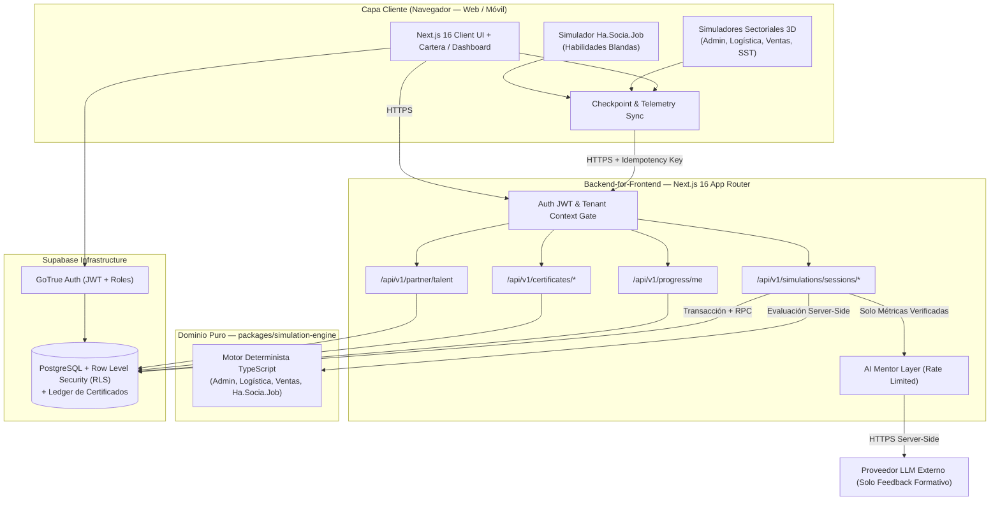
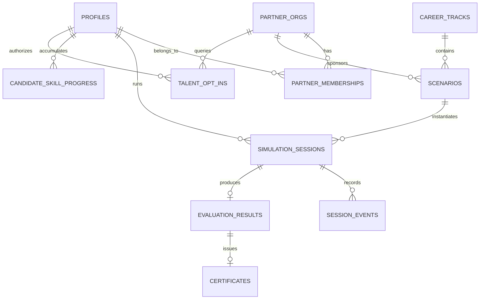

# PortalJob — Simulador Virtual de Prácticas Preprofesionales y Arquitectura Backend

<div align="center">


**Plataforma web B2B2C diseñada para resolver la falta de experiencia laboral juvenil en el Perú mediante un simulador virtual de prácticas preprofesionales basado en tareas reales de empresas (Administración, Logística, Ventas, redacción de documentos, gestión de datos y Seguridad y Salud en el Trabajo), entrenamiento de habilidades blandas con *Ha.Socia.Job*, retroalimentación con IA, certificación laboral verificable y cartera de talento en tiempo real.**

[Arquitectura del Sistema](docs/ARCHITECTURE.md) • [Esquema PostgreSQL & RLS](docs/BACKEND_SCHEMA.md) • [Contratos API](docs/API_CONTRACT.md) • [Motor TS vs. IA](docs/ENGINE_AND_AI_SEPARATION.md) • [Flujos End-to-End](docs/USER_AND_DATA_FLOWS.md)

</div>

---

> [!NOTE]
> **Transparencia de Estado del Repositorio (`Technical Blueprint`)**
> Este repositorio documenta la **arquitectura backend, modelo relacional, políticas de seguridad (RLS), contratos API y motor determinista en TypeScript puro** de **PortalJob** (incluyendo el módulo **Ha.Socia.Job**), proyecto reconocido como **Ganador Nacional en la Ideatón Por El Empleo Juvenil**.
>
> Aunque no se programó la versión final productiva completa en código, los artefactos técnicos aquí publicados constituyen un **blueprint listo para implementación** respaldado por investigación de mercado (INEI / ManPowerGroup), marco normativo peruano (Ley de Empleo Juvenil del MTPE y Ley N.º 29733) y proyección financiera integral.

---

## 1. Contexto del Problema, Datos de Mercado y Propuesta de Valor

### La Trampa de la Falta de Experiencia Laboral en Perú
En el Perú, miles de jóvenes —tanto estudiantes universitarios como jóvenes fuera de la educación formal— enfrentan la misma barrera estructural en puestos de entrada: **sin experiencia no hay trabajo, y sin trabajo no hay experiencia**.

Según datos oficiales del **INEI** citados en la investigación base de PortalJob (Lima Metropolitana):
* **71,400 empleos perdidos** para jóvenes de **14 a 24 años** en comparación con el periodo pre-pandemia.
* **130,000 jóvenes desempleados**, alcanzando una tasa de desempleo juvenil del **14.4%**.
* **84.9%** de los jóvenes menores de 25 años que acceden al mercado laboral lo hacen en condiciones de **informalidad**, sin beneficios sociales ni derechos laborales.

### Planteamiento de PortalJob (Simulador Virtual de Prácticas Preprofesionales)
PortalJob rompe este ciclo operando como un entorno virtual basado en **tareas y proyectos reales que practicantes pagados han ejecutado en empresas**, complementado por una red de ex-practicantes colaboradores y casos empresariales anonimizados:

| Pilar de PortalJob | Qué resuelve funcionalmente | Respaldo en la Arquitectura Backend |
| :--- | :--- | :--- |
| **1. Simuladores Técnicos por Sector** | Tareas reales en **Administración, Logística y Ventas**: redacción de documentos, gestión de datos, reportes, habilidades digitales y **Seguridad y Salud en el Trabajo (SST)**. | Checkpoints versionados (`state_snapshot`), bitácora *append-only* (`session_events`) e idempotencia ante micro-cortes. |
| **2. Ha.Socia.Job (Habilidades Blandas)** | Simulador dedicado a comunicación efectiva, liderazgo, pensamiento crítico, adaptabilidad y trabajo colaborativo. | Evaluador situacional determinista en TypeScript puro + rúbrica objetiva antes de invocar al mentor IA. |
| **3. Retroalimentación Inmediata con IA** | Analiza desempeño en tiempo real, identifica fortalezas/brechas y guía al joven en su mejora continua. | Capa LLM desacoplada del puntaje (`LLM ≠ Motor Numérico`), con caché y cuotas diarias por usuario. |
| **4. Verificación y Certificación Laboral** | Modelo de acreditación propuesto con respaldo de empresas aliadas, la plataforma y el **MTPE** (alineado a la Ley de Empleo Juvenil). | Tabla inmutable `certificates` ligada a `evaluation_results`, con `verification_code` único y RPC de consulta segura. |
| **5. Cartera de Talento en Tiempo Real** | Permite a empresas supervisar el progreso de candidatos capacitados y acelerar su intermediación laboral. | Políticas RLS multi-tenant, `talent_opt_ins` explícito (Ley N.º 29733) y filtros por vertical, puntaje y región. |

---

## 2. Mi Rol Técnico y Liderazgo como Arquitecto Backend

En la evolución técnica de **PortalJob** desde la propuesta conceptual del Ideatón hacia una arquitectura cloud moderna y escalable, lideré el diseño de infraestructura, datos y seguridad:

1. **Evolución del Stack Backend (`Next.js 16 App Router` + `Supabase`):** Reemplazo de la arquitectura conceptual inicial (Java/Python/HTML en Heroku) por un BFF unificado en **Next.js 16 App Router** y **Supabase (PostgreSQL + Auth + RLS)**, reduciendo latencia y costos operativos ([ADR-005](docs/adr/005-evolution-from-ideaton-stack-to-nextjs-supabase.md)).
2. **Arquitectura de Datos y Migraciones SQL:** Modelado completo de perfiles regionalizados, tracks sectoriales, sesiones con recuperación de estado, eventos idempotentes, certificaciones verificables y cartera de talento B2B.
3. **Ciberseguridad y Cumplimiento Ley N.º 29733 (Perú):** Políticas **Row Level Security (RLS)** *deny-by-default*, consentimiento explícito y revocable (`talent_opt_ins`) para visibilidad empresarial y bloqueos *anti-tampering* contra alteración de puntajes o certificados.
4. **Motor Determinista en TypeScript Puro (`packages/simulation-engine`):** Separación estricta entre el cálculo determinista de desempeño (KPIs, SLA, SST, gestión documental y *Ha.Socia.Job*) y la capa de interpretación con Inteligencia Artificial.
5. **APIs de Progreso, Supervisión en Tiempo Real y Certificación:** Route Handlers `/api/v1/*` para seguimiento de avance, verificación pública de certificados y filtrado B2B de talento.

---

## 3. Arquitectura del Sistema (Vista C4)



---

## 4. Separación Estricta: Motor Determinista vs. IA Personalizada

Para respaldar certificaciones laborales con valor institucional (MTPE y empresas aliadas), **la IA nunca califica ni modifica puntajes**:

```text
Eventos del Simulador (Admin / Logística / Ventas / Ha.Socia.Job)
              │
              ▼
  [ Motor Determinista en TypeScript Puro ]   ◄── 0 dependencias React / Red / LLM
   • Valida tiempos mínimos anti-trampa y orden secuencial
   • Evalúa KPIs por sector: reportes/datos, FEFO/SST, ética comercial, liderazgo
   • Calcula score (0-100), aprobación, XP y genera inputHash reproducible
              │
              ▼  (Persistencia atómica + emisión de certificado si aprueba)
    [ PostgreSQL + RLS + Ledger Inmutable ]
              │
              ▼  (Lectura read-only de brechas reales)
      [ Capa IA de Retroalimentación ]        ◄── Explica fortalezas y plan de mejora
```

> Revisar fórmulas y reglas por módulo en [docs/ENGINE_AND_AI_SEPARATION.md](docs/ENGINE_AND_AI_SEPARATION.md) y [ADR-001](docs/adr/001-deterministic-ts-engine-vs-ai.md).

---

## 5. Arquitectura de Datos, Certificación y Seguridad (RLS)



### Ciberseguridad y Cumplimiento Ley N.º 29733 (Protección de Datos Personales — Perú)
* **Frontera Zero-Trust en PostgreSQL (`002_rls_policies.sql`):** Acceso *deny-by-default* en todas las tablas.
* **Consentimiento Explícito y Supervisión Segura (`talent_opt_ins`):** Las empresas aliadas únicamente pueden supervisar sesiones en curso, progreso y evaluaciones de jóvenes que otorgaron consentimiento explícito y tienen `is_open_to_work = true`.
* **Anti-Tampering de Puntajes y Certificados:** Las tablas `evaluation_results`, `candidate_skill_progress` y `certificates` bloquean escritura directa desde clientes (`authenticated`); únicamente la RPC transaccional `commit_deterministic_evaluation` ejecutada en servidor (`service_role`) puede emitir notas, XP y credenciales.
* **Verificación Puntual sin Exposición Masiva:** `verify_certificate(code)` permite a empleadores validar un código específico de certificado sin poder listar ni extraer la base completa de jóvenes.

> Ver detalle completo en [docs/BACKEND_SCHEMA.md](docs/BACKEND_SCHEMA.md) y [ADR-004](docs/adr/004-verifiable-credentials-and-data-protection.md).

---

## 6. Módulos Cubiertos por el Motor y Catálogo Seed

| Vertical / Módulo | Código de Track | Competencias Evaluadas por el Motor TS |
| :--- | :--- | :--- |
| **Logística & Seguridad y Salud en el Trabajo (SST)** | `LOGISTICS_CORE` | Picking FIFO/FEFO, verificación obligatoria de EPP/SST, precisión de despacho y cumplimiento de SLA. |
| **Administración, Documentos & Gestión de Datos** | `ADMIN_CORE` | Redacción/auditoría de reportes operativos, conciliación de datos, herramientas digitales y resguardo de PII. |
| **Ventas & Atención Comercial** | `SALES_CORE` | Diagnóstico de necesidad del cliente, manejo de objeciones, ética comercial y tasa de cierre. |
| **Ha.Socia.Job (Habilidades Blandas)** | `HASOCIAJOB_SOFT` | Comunicación efectiva, liderazgo, pensamiento crítico, trabajo colaborativo y adaptabilidad. |

---

## 7. Superficie de APIs (Next.js 16 App Router)

| Método & Ruta | Propósito | Control de Seguridad |
| :--- | :--- | :--- |
| `GET /api/v1/health` | Estado del BFF, conectividad PostgreSQL y versión del motor | Público (sin PII) |
| `GET /api/v1/scenarios` | Catálogo filtrable (`administration`, `logistics`, `sales`, `hasociajob`) | Auth JWT + RLS |
| `POST /api/v1/simulations/sessions` | Inicia o reanuda sesión activa/pausada | Auth JWT + Índice único parcial |
| `PATCH /api/v1/simulations/sessions/[id]/checkpoint` | Guarda `state_snapshot` e inserta eventos idempotentes | Auth JWT + `state_version` optimista |
| `POST /api/v1/simulations/sessions/[id]/submit` | Ejecuta motor TS determinista, actualiza XP y emite certificado si aprueba | Auth JWT + Lock transaccional |
| `POST /api/v1/simulations/sessions/[id]/ai-feedback` | Genera retroalimentación personalizada y plan de mejora | Auth JWT + Rate Limit diario |
| `GET /api/v1/progress/me` | Progreso consolidado, nivel, XP por competencia y certificados propios | Auth JWT + RLS |
| `GET /api/v1/certificates/verify/[code]` | Validación de autenticidad de certificación laboral por empleadores | Código único verificable (sin exposición masiva) |
| `GET /api/v1/partner/talent` | Cartera de talento filtrable por vertical, score y región (`Lima`, `Piura`, `Lambayeque`, `Arequipa`) | Auth JWT + Membership B2B + Opt-in obligatorio |

> Especificación completa de payloads y códigos de error en [docs/API_CONTRACT.md](docs/API_CONTRACT.md).

---

## 8. Plan de Despliegue Regional, Alianzas y Proyección Financiera

### Despliegue Gradual en 3 Fases (con Indicadores ManPowerGroup 2024)
```text
Fase 1 — Inicial:      Lima Metropolitana
                       (Recopilación de métricas iniciales de simuladores y validación de rúbricas)
         │
         ▼
Fase 2 — Regional:     Piura (43%) • Lambayeque (30%) • Arequipa (29%)
                       (Expansión a regiones de mayor expectativa de demanda laboral — ManPowerGroup 2024)
         │
         ▼
Fase 3 — Nacional:     Cobertura Nacional Completa (proyección 18 meses)
                       (Optimización continua por feedback regional y alianzas multi-sector)
```

### Ecosistema de Alianzas y Viabilidad Estratégica Propuesta
* **Sector Público y Organismos Internacionales:** Articulación propuesta con el **MTPE** (y programas como **Impulsa Perú**), la **Organización Internacional del Trabajo (OIT)** y redes de cooperación internacional como **Alliance 2015 / Ayuda en Acción**.
* **Empresas Aliadas Objetivo (Contenido Real & Cartera de Talento):** **Fundación Romero, ManPowerGroup, BCP, Telefónica, Promart e Interbank** para proveer tareas reales anonimizadas de practicantes y acceder a talento pre-capacitado.
* **Red de Ex-Practicantes Colaboradores:** Aprovechamiento de jóvenes ocupados que aportan retroalimentación sobre tareas reales para mantener actualizados los módulos.

### Proyección Financiera de Implementación (Propuesta Integral)

| Partida Presupuestal | Rango Estimado (USD) | Alcance Principal |
| :--- | :---: | :--- |
| **Desarrollo tecnológico** | USD 35,000 – 41,000 | Construcción MVP completo (Simuladores, *Ha.Socia.Job*, BFF Next.js, motor TS e IA). |
| **Infraestructura y soporte** | USD 13,000 – 16,500 | Supabase/PostgreSQL, hosting serverless, cifrado, monitoreo y soporte operativo. |
| **Recursos humanos** | USD 78,000 – 93,000 | Equipo multidisciplinario (Ingeniería, Diseño UX/3D, Pedagogía Laboral, Gestión). |
| **Promoción y alianzas** | USD 14,000 – 18,000 | Campañas en universidades, LinkedIn, redes sociales, ONGs y articulación empresarial. |
| **Mantenimiento y expansión** | USD 80,000 | Operación continua y escalamiento regional (Lima → Piura / Lambayeque / Arequipa → Nacional en 18 meses). |
| **Total Estimado** | **USD 220,000 – 250,500** | **Cobertura integral de desarrollo, seguridad, alianzas y expansión nacional.** |

---

## 9. Estructura del Repositorio y Verificación Local

```text
portal-job/
├── README.md                                                    # Documento maestro: contexto INEI/MTPE, rol backend y blueprint
├── LICENSE                                                      # Licencia MIT
├── .env.example                                                 # Plantilla segura de variables de entorno
├── docs/
│   ├── ARCHITECTURE.md                                          # Diagramas C4, regionalización (Piura/Lambayeque/Arequipa) y seguridad
│   ├── BACKEND_SCHEMA.md                                        # ERD, certificados, RLS multi-tenant e índices
│   ├── API_CONTRACT.md                                          # Contratos REST v1, verificación de certificados y cartera B2B
│   ├── ENGINE_AND_AI_SEPARATION.md                              # Motor TS (Admin, Logística, Ventas, Ha.Socia.Job) vs. IA
│   ├── USER_AND_DATA_FLOWS.md                                   # Secuencias end-to-end y máquina de estados
│   └── adr/
│       ├── 001-deterministic-ts-engine-vs-ai.md                 # Separación estricta scoring determinista vs. LLM
│       ├── 002-supabase-rls-multitenancy.md                     # RLS deny-by-default para B2C y empresas aliadas
│       ├── 003-nextjs16-bff-and-state-persistence.md            # Checkpoints versionados e idempotencia
│       ├── 004-verifiable-credentials-and-data-protection.md    # Certificación verificable y Ley N.º 29733
│       └── 005-evolution-from-ideaton-stack-to-nextjs-supabase.md # Evolución desde stack inicial Ideatón a Next.js 16 + Supabase
├── supabase/
│   └── migrations/
│       ├── 001_init_schema.sql                                  # DDL: tracks, escenarios, sesiones, evaluaciones y certificados
│       ├── 002_rls_policies.sql                                 # Políticas RLS multi-tenant y supervisión segura
│       ├── 003_triggers_and_functions.sql                       # Triggers anti-tamper, RPC transaccional y verify_certificate
│       └── 004_seed_catalog.sql                                 # Seed real: Logística/SST, Administración/Datos, Ventas y Ha.Socia.Job
└── packages/
    └── simulation-engine/
        ├── tsconfig.json                                        # Configuración TypeScript estricta (0 deps externas)
        ├── types.ts                                             # Contratos de dominio para las 4 verticales
        ├── scoring-contract.ts                                  # Motor determinista puro y máquina de estados
        └── scoring-contract.test.ts                             # Suite ejecutable (node --test)
```

### Verificación Local del Motor Determinista
El contrato del motor en TypeScript puro se ejecuta directamente con Node.js 22.6+/24+ sin instalar dependencias:

```bash
node --test packages/simulation-engine/scoring-contract.test.ts
```

---

<div align="center">

**Autor & Arquitecto Backend:** Max Clever Quintana Morales  
[LinkedIn](https://www.linkedin.com/in/max-quintana-morales/) • [GitHub](https://github.com/waxmorales)

</div>
