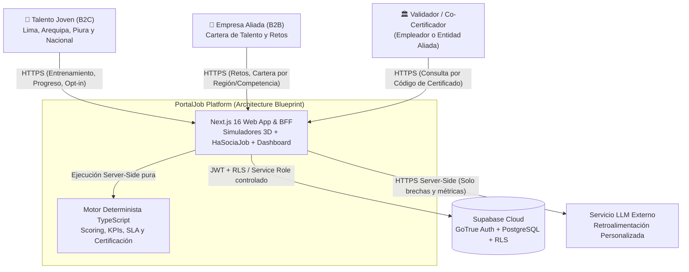
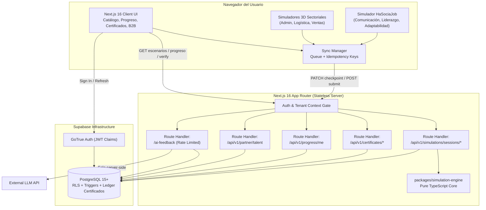

# Arquitectura del Sistema — PortalJob

Este documento describe la arquitectura técnica diseñada para **PortalJob** (incluyendo el simulador de habilidades blandas **HaSociaJob**) bajo el estándar **C4**, asegurando escalabilidad progresiva desde Lima hacia Arequipa, Piura y cobertura nacional en 18 meses, con altos estándares de ciberseguridad y protección de datos.

---

## 1. Vista de Contexto (C4 Nivel 1)

PortalJob opera como un ecosistema **B2B2C** con cuatro pilares integrados: simulación técnica sectorial (**Administración, Logística, Ventas**), entrenamiento de habilidades blandas (**HaSociaJob**), **certificación laboral verificable** e **intermediación laboral**.



### Fronteras de Responsabilidad
1. **Cliente (Navegador):** Ejecuta la interfaz interactiva de los módulos de **Administración, Logística, Ventas** y **HaSociaJob**, sincronizando checkpoints y telemetría discreta mediante llaves de idempotencia. No tiene autoridad para calcular ni modificar notas.
2. **Next.js 16 App Router (BFF):** Centraliza autenticación JWT, validación Zod, ejecución determinista del scoring, emisión de certificados verificables y cuotas del servicio IA.
3. **Supabase (PostgreSQL + RLS):** Fuente única de verdad con aislamiento multi-tenant por fila, trazabilidad de evaluaciones y resguardo de consentimientos explícitos.

---

## 2. Vista de Contenedores (C4 Nivel 2)



---

## 3. Capas Lógicas del Backend

```text
app/api/v1/**  (Transporte HTTP + Zod Validation + Auth/Role Gate + Rate Limiting)
      │
      ▼
lib/services/** (Orquestación: Sesiones, Certificación, Feedback IA, Cartera B2B)
      │
      ├─────────────────────────────────────────┐
      ▼                                         ▼
packages/simulation-engine/**            lib/repositories/**
(Reglas puras TS: Admin/Log/Ventas/      (Queries tipadas + RPC transaccional
 HaSociaJob — 0 I/O, 0 Red, 0 LLM)       en Supabase/PostgreSQL)
```

---

## 4. Ciberseguridad, Protección de Datos y Escalabilidad Nacional

| Requisito de PortalJob | Solución Arquitectónica Diseñada |
| :--- | :--- |
| **Protección de datos juveniles (Ley N.º 29733 — Perú)** | Principio de mínimo privilegio en RLS (`002_rls_policies.sql`), consentimiento explícito y revocable (`talent_opt_ins`) antes de exponer perfil a empresas en la cartera de talento. |
| **Integridad de certificaciones laborales** | Cada certificado se vincula a una evaluación inmutable (`evaluation_id`), incluye `verification_code` único e `input_hash` reproducible; verificación pública vía RPC controlada sin listar usuarios. |
| **Cobertura Lima → Arequipa → Piura → Nacional (18 meses)** | BFF *stateless* escalable horizontalmente, campo `region` indexado en `profiles` y `partner_orgs` para segmentar demanda laboral local y minimizar consultas costosas. |
| **Resiliencia ante conectividad móvil limitada** | Persistencia incremental en `state_snapshot` (`state_version` optimista) y eventos idempotentes que evitan pérdida de progreso en zonas fuera de Lima metropolitana. |
| **Control de presupuesto tecnológico (Infraestructura USD 13k–16.5k)** | Scoring determinista ejecutado en `< 5 ms` sin llamadas a GPUs/LLMs externas; la IA solo redacta feedback post-evaluación bajo cuota diaria cacheable. |
