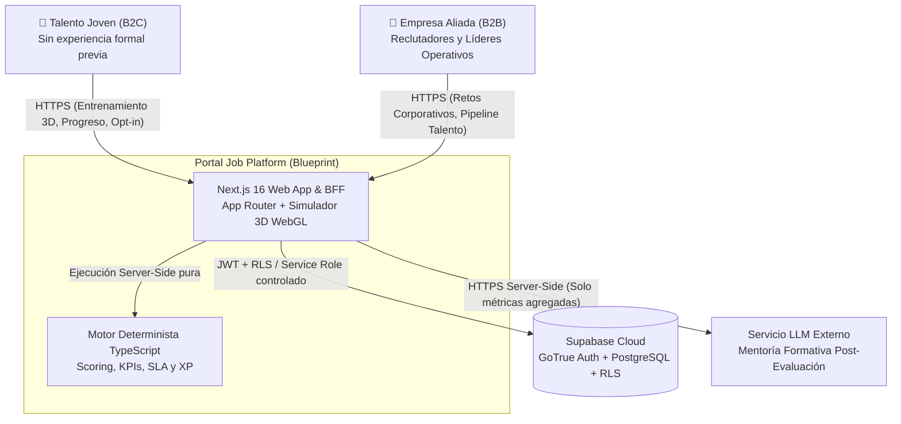
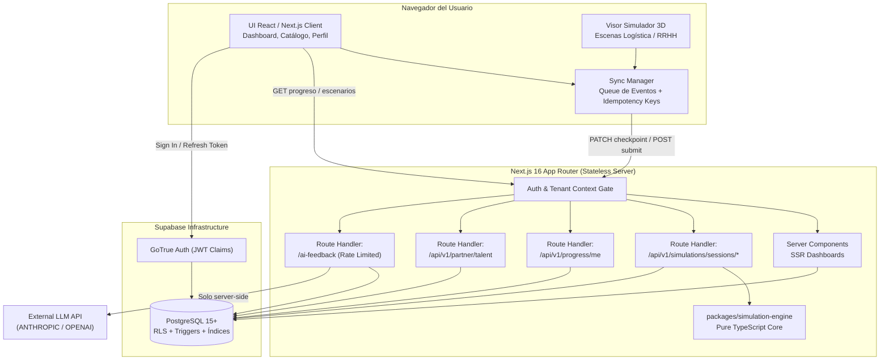

# Arquitectura del Sistema — Portal Job

Este documento describe la arquitectura técnica propuesta y validada para **Portal Job**, siguiendo el estándar **C4** (Contexto, Contenedores y Límites de Seguridad) con foco en resiliencia, escalabilidad y separación estricta entre evaluación determinista y capa de Inteligencia Artificial.

---

## 1. Vista de Contexto (C4 Nivel 1)

Portal Job opera como una plataforma **B2B2C** que conecta dos perfiles con incentivos complementarios a través de un núcleo de simulación verificable:



### Fronteras de Responsabilidad
1. **El Cliente (Navegador):** Renderiza la experiencia 3D gamificada, captura acciones discretas del usuario y mantiene un buffer local tolerante a micro-cortes, pero **no es fuente de autoridad** para puntajes ni XP.
2. **Next.js 16 App Router (BFF):** Orquesta la autenticación de sesión, valida contratos de entrada (Zod), ejecuta el motor determinista de evaluación en el servidor al cierre de la misión y aplica control de cuotas hacia proveedores externos de IA.
3. **Supabase (PostgreSQL + RLS):** Actúa como única fuente de verdad persistente y frontera de aislamiento multi-tenant mediante *Row Level Security*.

---

## 2. Vista de Contenedores (C4 Nivel 2)



---

## 3. Arquitectura Lógica del Backend (Capas)

Para evitar acoplamiento entre infraestructura web y reglas de negocio, el backend se estructura en cuatro capas con dependencias unidireccionales:

```text
app/api/v1/**  (Capa Transporte HTTP + Zod Validation + Auth Context)
      │
      ▼
lib/services/** (Casos de Uso: Inicio de Sesión, Checkpoint, Submit, Pipeline B2B)
      │
      ├───────────────────────────────────────┐
      ▼                                       ▼
packages/simulation-engine/**          lib/repositories/**
(Reglas puras TS: 0 I/O, 0 red)        (Queries tipadas a Supabase/PostgreSQL)
```

### Reglas Estrictas de Dependencia
* `packages/simulation-engine` **no importa** `next/*`, `react`, `@supabase/*` ni SDKs de IA. Esto permite testear el motor en milisegundos con pruebas unitarias deterministas y reutilizarlo sin cambios en workers asíncronos futuros.
* Toda mutación de estado sensible (`xp_awarded`, `final_score`, `passed`, `evaluation_results`) ocurre exclusivamente en el servidor dentro de `lib/services/` tras validar la propiedad de la sesión y la coherencia temporal de los eventos.

---

## 4. Decisiones Clave de Estabilidad y Escalabilidad

| Desafío Técnico | Solución Arquitectónica Diseñada | Impacto en Producción |
| :--- | :--- | :--- |
| **Desconexiones durante simulación 3D (10–30 min)** | Checkpoints incrementales en JSONB con `state_version` optimista + bitácora `session_events` con `idempotency_key`. | Cero pérdida de avance del usuario; reintentos seguros sin duplicar eventos. |
| **Trampas o manipulación de requests desde el cliente** | El cliente envía **eventos de acción** (qué eligió/movió y cuándo), nunca el puntaje final. El servidor recalcula con el motor TS. | Integridad comercial frente a empresas aliadas: el dossier refleja desempeño real. |
| **Latencia y costos de llamadas a LLMs** | Cálculo de score en `< 5 ms` vía TypeScript puro; la IA se invoca bajo demanda/post-cierre con cuota diaria por usuario. | El core del simulador funciona incluso si la API de IA externa está degradada. |
| **Aislamiento de datos entre empresas aliadas y jóvenes** | Row Level Security (RLS) en PostgreSQL + tabla explícita `talent_opt_ins` para visibilidad B2B. | Cumplimiento de privacidad: ninguna empresa ve candidatos sin consentimiento previo. |
| **Crecimiento de tabla `session_events`** | Separación física entre eventos detallados (escritura *append-only*) y tabla resumen `candidate_skill_progress` (lectura rápida). | El dashboard del usuario y los filtros B2B mantienen lecturas $O(\log n)$ indexadas. |

---

## 5. Estrategia de Despliegue y Entornos

```text
[ Local Dev ]  ──►  [ Staging / Preview ]  ──►  [ Production ]
Supabase CLI         Supabase Staging Branch     Supabase Prod (RLS + PITR)
Next.js Dev          Vercel Preview              Vercel Edge/Serverless
```

* **Variables de Entorno Segregadas:** `SUPABASE_SERVICE_ROLE_KEY` y `AI_PROVIDER_API_KEY` residen únicamente en secretos del servidor; jamás llevan prefijo `NEXT_PUBLIC_`.
* **Migraciones Versionadas:** Todo cambio de esquema pasa por archivos SQL inmutables en `supabase/migrations/` (`001` a `004`), asegurando paridad entre desarrollo, pruebas y producción.
* **Degradación Elegante:** Si el servicio de IA Mentor excede cuota o falla por timeout, la simulación se guarda y puntúa normalmente y el endpoint retorna `ai_status: "deferred"` para reintento posterior sin bloquear al usuario.
