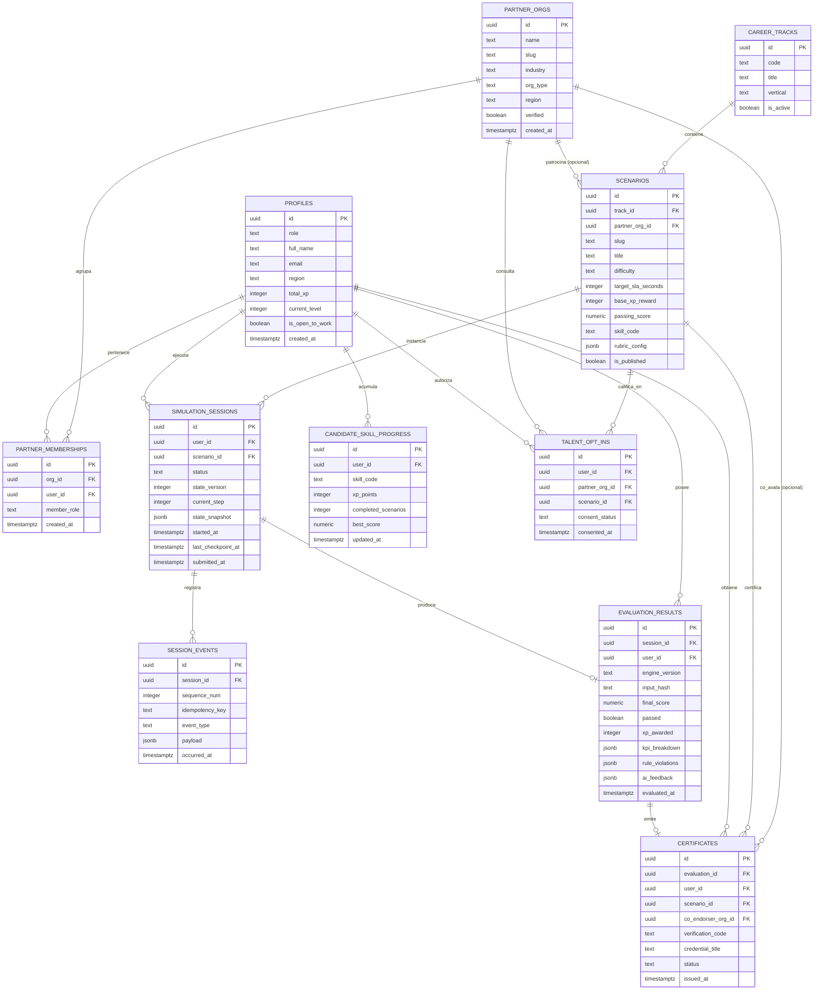

# Arquitectura de Base de Datos, Certificación y Seguridad RLS — PortalJob

Este documento especifica el modelo relacional en **PostgreSQL (Supabase)** para **PortalJob** y **HaSociaJob**, incluyendo el diagrama entidad–relación, la emisión verificable de certificaciones laborales, la segmentación regional (Lima, Arequipa, Piura) y la matriz de seguridad **Row Level Security (RLS)**.

> El DDL completo y las políticas SQL se encuentran en [`supabase/migrations/`](../supabase/migrations/001_init_schema.sql).

---

## 1. Diagrama Entidad–Relación (ERD)

---

## 2. Dominios del Modelo de Datos

### A. Identidad, Regionalización y Aliados (`profiles`, `partner_orgs`, `partner_memberships`)
* **`profiles`:** Extiende `auth.users` incorporando `role` (`candidate`, `partner_recruiter`, `platform_admin`), `region` (por defecto `'Lima'`, soportando expansión a `'Piura'`, `'Lambayeque'`, `'Arequipa'` y cobertura nacional), `total_xp`, `current_level` e `is_open_to_work`.
* **`partner_orgs`:** Modela empresas aliadas (`corporate`), instituciones públicas (`public_entity`) o aliados de ecosistema (`ecosystem_partner`) con verificación institucional (`verified`) y `region`.

### B. Catálogo de Simuladores (`career_tracks`, `scenarios`)
* **`career_tracks.vertical`:** Cubre exactamente las 4 verticales reales de PortalJob:
  * `'administration'` — Administración y gestión de reportes/habilidades digitales.
  * `'logistics'` — Logística, inventario y protocolos de seguridad laboral.
  * `'sales'` — Ventas, gestión comercial y atención al cliente.
  * `'hasociajob'` — Módulo de habilidades blandas (comunicación efectiva, liderazgo, resolución de problemas, trabajo en equipo, adaptabilidad).
* **`scenarios`:** Define `target_sla_seconds`, `base_xp_reward`, `passing_score`, `skill_code` y la rúbrica estructurada `rubric_config` (`jsonb`).

### C. Persistencia de Estado y Telemetría (`simulation_sessions`, `session_events`)
* **`simulation_sessions`:** Máquina de estados resumible con `state_version` optimista y `state_snapshot` (`jsonb`) para retomar simulaciones ante caídas de red.
* **`session_events`:** Bitácora *append-only* con `UNIQUE (session_id, idempotency_key)` y `UNIQUE (session_id, sequence_num)` para auditoría anti-trampa y reintentos idempotentes.

### D. Evaluación, Certificación Laboral e Intermediación (`evaluation_results`, `certificates`, `candidate_skill_progress`, `talent_opt_ins`)
* **`evaluation_results`:** Ledger determinista (`engine_version`, `input_hash`, `final_score`, `passed`, `xp_awarded`, `kpi_breakdown`, `rule_violations`) separado de `ai_feedback`.
* **`certificates`:** Credencial emitida automáticamente por el servidor cuando `passed = true`, con `verification_code` único (ej. `PJ-2026-XXXXXXXX`), vínculo a `evaluation_id` y referencia opcional a `co_endorser_org_id` para escenarios patrocinados o co-avalados.
* **`candidate_skill_progress` & `talent_opt_ins`:** Resumen indexado de competencias y consentimiento explícito del candidato para aparecer en la **cartera de talento capacitado** de una organización aliada.

---

## 3. Estrategia de Índices para Escalabilidad

| Índice | Tabla | Propósito |
| :--- | :--- | :--- |
| `ux_active_session_per_user_scenario` | `simulation_sessions` | **Índice único parcial** (`WHERE status IN ('in_progress', 'paused')`) que impide sesiones simultáneas duplicadas. |
| `ix_sessions_user_recent` | `simulation_sessions` | Historial del candidato ordenado por fecha (`user_id, started_at DESC`). |
| `ux_session_event_idempotency` | `session_events` | Idempotencia exacta en reintentos de red (`session_id, idempotency_key`). |
| `ix_profiles_region_open` | `profiles` | Segmentación geográfica para expansión Lima → Piura / Lambayeque / Arequipa (`region, is_open_to_work`). |
| `ux_certificates_verification_code` | `certificates` | Búsqueda instantánea $O(\log n)$ al validar un certificado laboral por código. |
| `ix_optins_partner_status` | `talent_opt_ins` | Consultas de cartera de talento en `/api/v1/partner/talent`. |

---

## 4. Matriz de Seguridad Row Level Security (RLS)

Todas las tablas habilitan `ROW LEVEL SECURITY` en modo *deny-by-default*.

| Tabla | `SELECT` | `INSERT` | `UPDATE` | `DELETE` |
| :--- | :--- | :--- | :--- | :--- |
| `profiles` | Propio usuario (`auth.uid() = id`) o Partner si existe `talent_opt_ins = 'granted'` | Trigger `on_auth_user_created` | Propio usuario (trigger bloquea cambios a `role`, `total_xp`, `current_level`) | Denegado |
| `partner_orgs` | Organizaciones verificadas o miembros de la org | Solo `service_role` | Admins de la org | Denegado |
| `career_tracks` / `scenarios` | Activos/publicados o miembros del partner dueño | Admins del partner o `service_role` | Admins del partner o `service_role` | Denegado |
| `simulation_sessions` | Propio usuario (`auth.uid() = user_id`) o Partner con opt-in vigente (supervisión en tiempo real) | Propio usuario (`status = 'in_progress'`) | Propio usuario solo en estados activos (trigger bloquea `'evaluated'` desde cliente) | Denegado |
| `session_events` | Propio usuario (vía `session_id`) | Propio usuario mientras la sesión esté activa | Denegado (inmutable) | Denegado |
| `evaluation_results` | Propio usuario o Partner con opt-in vigente | **Solo `service_role`** | **Solo `service_role`** (solo `ai_feedback`) | Denegado |
| `certificates` | Propio usuario o Partner con opt-in vigente (y verificación puntual vía RPC `verify_certificate`) | **Solo `service_role` / RPC** | **Solo `service_role`** | Denegado |
| `candidate_skill_progress` | Propio usuario o Partner con opt-in vigente | **Solo `service_role` / RPC** | **Solo `service_role` / RPC** | Denegado |
| `talent_opt_ins` | Propio candidato o miembros de `partner_org_id` | Propio candidato | Propio candidato | Propio candidato |
