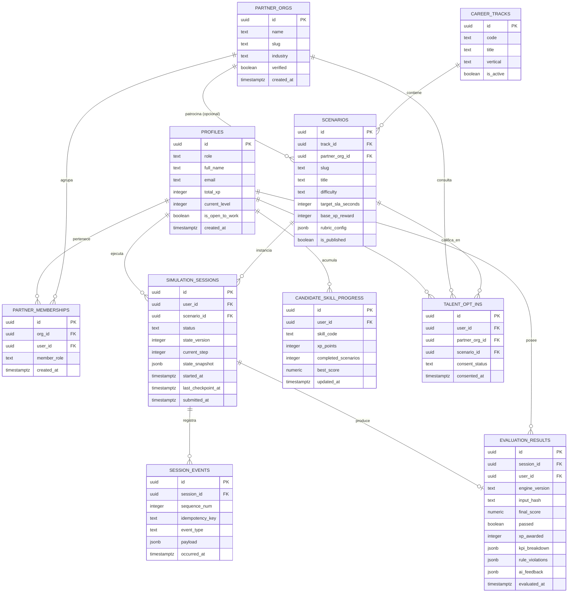

# Arquitectura de Base de Datos y Seguridad RLS — Portal Job

Este documento especifica el modelo de datos en **PostgreSQL (Supabase)** diseñado para **Portal Job**, cubriendo el diagrama entidad-relación, contratos de tablas, estrategia de indexación, triggers de consistencia y matriz completa de políticas **Row Level Security (RLS)**.

> El DDL completo y las políticas SQL se encuentran en [`supabase/migrations/`](../supabase/migrations/001_init_schema.sql).

---

## 1. Diagrama Entidad–Relación (ERD)



---

## 2. Dominios del Modelo de Datos

### A. Identidad y Multi-Tenancy (`profiles`, `partner_orgs`, `partner_memberships`)
* **`profiles`:** Extiende `auth.users` con `role` (`candidate`, `partner_recruiter`, `platform_admin`), XP acumulado y bandera `is_open_to_work`.
* **`partner_orgs` & `partner_memberships`:** Permiten que múltiples reclutadores pertenezcan a una misma empresa aliada sin mezclar permisos entre empresas competidoras.

### B. Catálogo Formativo y Retos 3D (`career_tracks`, `scenarios`)
* **`career_tracks`:** Verticales laborales (ej. `LOGISTICS`, `HR`, `OPERATIONS`).
* **`scenarios`:** Define cada misión 3D gamificada, incluyendo `partner_org_id` nullable (escenarios base de Portal Job vs. retos patrocinados por una empresa aliada), `target_sla_seconds` y `rubric_config` (`jsonb`) consumido por el motor TypeScript.

### C. Persistencia de Estado y Telemetría (`simulation_sessions`, `session_events`)
* **`simulation_sessions`:**
  * Mantiene la máquina de estados: `in_progress`, `paused`, `submitted`, `evaluated`, `abandoned`, `expired`.
  * **`state_version` (`integer`):** Impide sobrescritura silenciosa cuando llegan dos peticiones concurrentes (control de concurrencia optimista).
  * **`state_snapshot` (`jsonb`):** Almacena la posición lógica de la misión 3D (inventario en carrito, orden de despacho, candidatos revisados, paso actual) para reanudación exacta.
* **`session_events`:**
  * Tabla *append-only* con `UNIQUE (session_id, idempotency_key)` y `UNIQUE (session_id, sequence_num)`.
  * Permite reconstruir la línea temporal exacta de decisiones y detectar anomalías (ej. completar una misión compleja en 3 segundos).

### D. Evaluación Verificada y Pipeline B2B (`evaluation_results`, `candidate_skill_progress`, `talent_opt_ins`)
* **`evaluation_results`:** Guarda el dictamen inmutable del motor determinista (`engine_version`, `input_hash`, `final_score`, `xp_awarded`, `kpi_breakdown`, `rule_violations`) separado del campo `ai_feedback` (`jsonb` nullable).
* **`candidate_skill_progress`:** Tabla de lectura rápida agregada por `(user_id, skill_code)` mantenida transaccionalmente tras cada evaluación aprobada.
* **`talent_opt_ins`:** Registra el consentimiento explícito del candidato para compartir su perfil y métricas de desempeño con una `partner_org` específica.

---

## 3. Estructura de Campos JSONB Clave

### `simulation_sessions.state_snapshot` (Ejemplo Logística)
```json
{
  "schemaVersion": 1,
  "vertical": "logistics",
  "elapsedSeconds": 245,
  "currentZone": "Aisle-B",
  "carriedItems": [
    { "sku": "SKU-104", "batch": "LOT-2026-01", "qty": 2 }
  ],
  "completedCheckpoints": ["ppe_check_passed", "zone_a_picked"],
  "safetyFlags": []
}
```

### `evaluation_results.kpi_breakdown`
```json
{
  "accuracyPct": 96.5,
  "slaCompliancePct": 91.0,
  "protocolAdherencePct": 100.0,
  "efficiencyMultiplier": 1.15,
  "rawDurationSeconds": 412,
  "targetSlaSeconds": 480
}
```

---

## 4. Estrategia de Índices para Escalabilidad

| Índice | Tabla | Propósito |
| :--- | :--- | :--- |
| `ux_active_session_per_user_scenario` | `simulation_sessions` | **Índice único parcial** (`WHERE status IN ('in_progress', 'paused')`): garantiza a nivel de DB que un usuario no abra sesiones duplicadas simultáneas en la misma misión. |
| `ix_sessions_user_recent` | `simulation_sessions` | Acelera el historial del candidato ordenado por fecha (`user_id, started_at DESC`). |
| `ux_session_event_idempotency` | `session_events` | Garantiza idempotencia exacta en reintentos de red (`session_id, idempotency_key`). |
| `ix_eval_user_score` | `evaluation_results` | Acelera consultas de ranking personal y métricas por escenario (`user_id, evaluated_at DESC`). |
| `ix_optins_partner_status` | `talent_opt_ins` | Optimiza el endpoint B2B `/api/v1/partner/talent` filtrando por empresa y estado `granted`. |

---

## 5. Matriz de Seguridad Row Level Security (RLS)

Por defecto, todas las tablas tienen `ALTER TABLE ... ENABLE ROW LEVEL SECURITY`. Sin política explícita, PostgreSQL deniega todo acceso (`deny-by-default`).

| Tabla | `SELECT` | `INSERT` | `UPDATE` | `DELETE` |
| :--- | :--- | :--- | :--- | :--- |
| `profiles` | Propio usuario (`auth.uid() = id`) o Partner si existe `talent_opt_ins` con `consent_status = 'granted'` | Solo trigger `on_auth_user_created` | Propio usuario (sin escalar `role`, `total_xp` ni `current_level`) | Denegado |
| `partner_orgs` | Miembros de la org o catálogo verificado | Solo `service_role` / Admin | Admins de la org | Denegado |
| `career_tracks` / `scenarios` | Usuarios autenticados si `is_published = true` (o miembros del partner dueño) | Miembros `admin` del partner o `service_role` | Miembros `admin` del partner o `service_role` | Denegado |
| `simulation_sessions` | Propio usuario (`auth.uid() = user_id`) | Propio usuario con `status = 'in_progress'` | Propio usuario solo en `state_snapshot`/`status` no evaluado; transición a `evaluated` reservada a `service_role` | Denegado (auditoría) |
| `session_events` | Propio usuario (vía `session_id`) | Propio usuario mientras la sesión esté activa (`in_progress`/`paused`) | Denegado (inmutable / *append-only*) | Denegado |
| `evaluation_results` | Propio usuario o Partner con opt-in vigente | **Solo `service_role` (motor servidor)** | **Solo `service_role` (solo columna `ai_feedback`)** | Denegado |
| `candidate_skill_progress` | Propio usuario o Partner con opt-in vigente | **Solo `service_role` / Trigger** | **Solo `service_role` / Trigger** | Denegado |
| `talent_opt_ins` | Propio candidato o miembros de `partner_org_id` | Propio candidato (`auth.uid() = user_id`) | Propio candidato (revocar o reactivar consentimiento) | Propio candidato |
