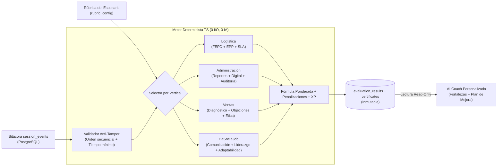

# Motor Determinista en TypeScript Puro vs. IA Personalizada — PortalJob

Este documento define la frontera estricta entre el **procesamiento numérico determinista** de competencias laborales (`packages/simulation-engine`) y la **retroalimentación personalizada por Inteligencia Artificial**.

---

## 1. Principio Central: `LLM ≠ Evaluador de Certificación`

PortalJob busca emitir **certificaciones laborales con valor real ante empresas aliadas y entidades como el MTPE**. Por ello, ningún puntaje ni certificado puede depender de la variabilidad estocástica de un LLM:

1. **Reproducibilidad 100%:** Ante una auditoría de empleador, los mismos eventos y rúbrica siempre generan exactamente el mismo `finalScore`, `kpiBreakdown` e `inputHash`.
2. **Inmunidad frente a *Prompt Injection*:** Los textos ingresados por un usuario en simulaciones de Ventas, Administración o *HaSociaJob* se evalúan por reglas estructuradas y criterios explícitos, nunca pidiéndole al LLM que decida si el usuario aprueba.
3. **Resiliencia operativa y control de costos:** El motor corre en `< 5 ms` en TypeScript puro con costo cero de API externa; el servicio de IA solo redacta la mentoría formativa posterior.

---

## 2. Cobertura de las 4 Verticales en `packages/simulation-engine`

---

## 3. Modelo Matemático Unificado por Dimensiones

Para las cuatro verticales (`logistics`, `administration`, `sales`, `hasociajob`), el motor calcula tres dimensiones normalizadas en $[0, 100]$ y aplica penalizaciones explícitas por infracciones críticas:

$$P = \operatorname{clamp}_{[0, 100]}\Big( w_{\text{acc}} \cdot K_{\text{acc}} + w_{\text{sla}} \cdot K_{\text{sla}} + w_{\text{proto}} \cdot K_{\text{proto}} - \sum_{v \in V} \text{penalty}(v) \Big)$$

| Vertical | Qué mide $K_{\text{acc}}$ (Precisión) | Qué mide $K_{\text{proto}}$ (Protocolo / Conducta) | Penalizaciones Críticas ($V$) |
| :--- | :--- | :--- | :--- |
| **Logística** | Picking exacto por SKU, cantidad y rotación FEFO/FIFO | Uso completo de EPP obligatorio antes de operar | `MISSING_PPE_*`, `WRONG_FEFO_BATCH` |
| **Administración** | Exactitud en conciliación de reportes y detección de anomalías | Uso de herramientas digitales y resguardo de confidencialidad | `UNVERIFIED_REPORT_SUBMITTED`, `DATA_EXPOSURE_RISK` |
| **Ventas** | Diagnóstico de necesidad y resolución correcta de objeciones | Transparencia comercial (sin promesas falsas) | `MISLEADING_SALES_CLAIM`, `SKIPPED_NEEDS_DISCOVERY` |
| **HaSociaJob** | Calidad de decisiones en comunicación efectiva, liderazgo, resolución de problemas y adaptabilidad | Respeto, escucha activa y colaboración en equipo | `NON_COLLABORATIVE_ESCALATION`, `LEADERSHIP_AVOIDANCE` |

### Otorgamiento de XP y Elegibilidad de Certificación
* Si `finalScore >= passingScore`: `passed = true`, se multiplica la recompensa por eficiencia temporal (`1.15` dentro del SLA objetivo) y el servidor dispara la emisión de la credencial en `certificates`.
* Si `finalScore < passingScore`: `passed = false`, se otorga XP formativo mínimo por el intento sin emitir certificación laboral.
