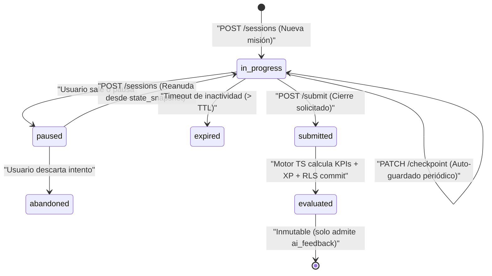
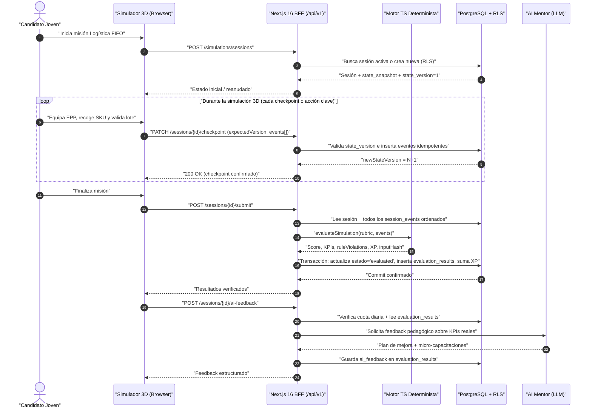
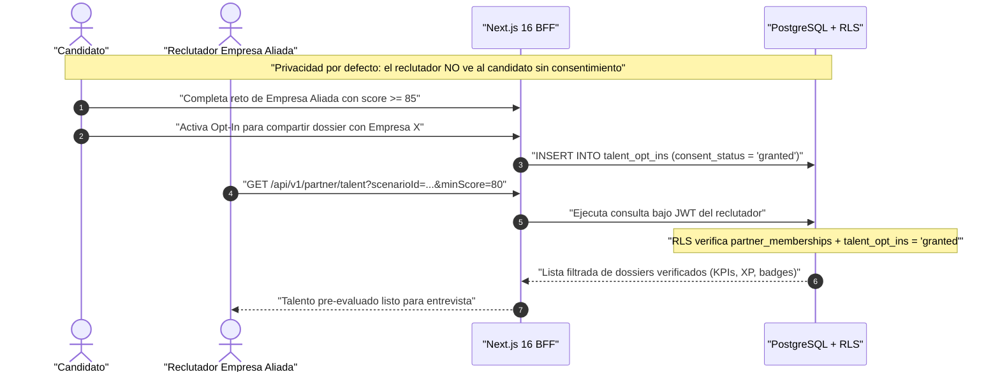

# Flujos de Usuario, Estado y Datos — Portal Job

Este documento detalla los flujos operativos end-to-end que garantizan la coherencia entre la experiencia gamificada 3D, la persistencia en backend y el valor B2B para empresas aliadas.

---

## 1. Máquina de Estados de una Sesión de Simulación

### Invariantes de Transición
* Una sesión en estado `evaluated`, `abandoned` o `expired` **no puede volver** a `in_progress`.
* El índice único parcial `ux_active_session_per_user_scenario` garantiza que un candidato solo tenga **una** sesión en estado `in_progress` o `paused` por escenario al mismo tiempo.

---

## 2. Flujo de Ejecución, Checkpoints y Evaluación (Candidato B2C)

---

## 3. Flujo de Visibilidad y Matching B2B (Empresa Aliada)

---

## 4. Flujo de Recuperación ante Caída de Red

1. **Pérdida momentánea de conexión:** El `Sync Manager` del cliente retiene los eventos locales con su `sequenceNum` e `idempotencyKey` determinístico (UUID v4 generado al ocurrir la acción).
2. **Reconexión o recarga de pestaña:** Al volver, `POST /simulations/sessions` detecta la sesión `in_progress` existente y devuelve `state_snapshot` + último `state_version`.
3. **Envío seguro de pendientes:** Si el cliente reenvía un lote cuyo checkpoint anterior ya había impactado la base de datos pero cuya respuesta HTTP se perdió, `ON CONFLICT (session_id, idempotency_key) DO NOTHING` evita duplicar eventos y el backend responde con el estado sincronizado.
