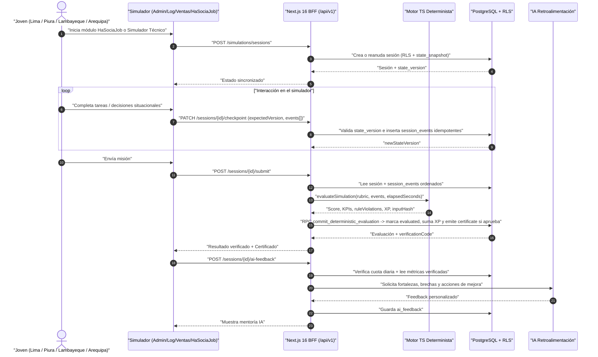
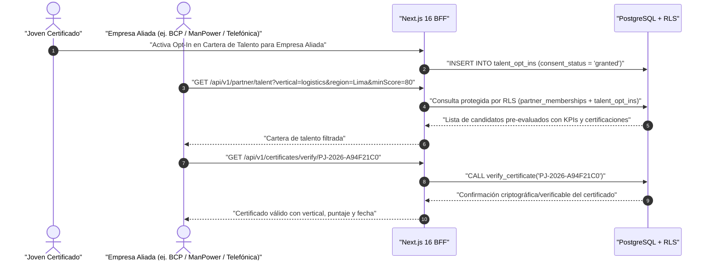

# Flujos de Usuario, Certificación y Cartera de Talento — PortalJob

Este documento detalla los flujos operativos end-to-end de **PortalJob** (incluyendo **HaSociaJob**, certificación verificable e intermediación laboral regional).

---

## 1. Máquina de Estados de una Sesión de Simulación

---

## 2. Flujo Integral: Simulación → Motor TS → Certificado → Mentor IA

---

## 3. Flujo de Intermediación Laboral y Verificación de Certificados (B2B)

